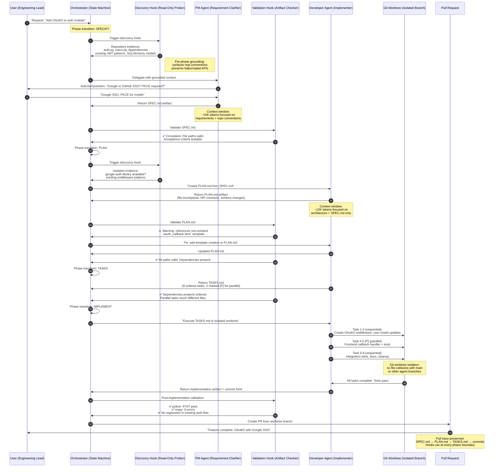

> "The context window is everything the model can 'see' at once when generating its next response. Unfortunately, using context has a slight impact on performance — attention gets spread across more tokens, and older, irrelevant content starts to distract from the current task."
> — Anthropic, *Using Claude Code: Session Management and 1M Context*

We have spent the last two years obsessing over model size, reasoning depth, and token output limits. But the real bottleneck in AI-assisted engineering and research is not how smart the model is — it is how much of your work it can hold in working memory at once. The context window is the new RAM, and most users are running out of it long before they run out of ideas.

This post is about the architectures, tools, and research patterns that let you run **multiple agents in parallel** without collapsing under context rot. Whether you are using Claude Code, Pi, Devin, or open-source frameworks, the same principle applies: **isolated context windows, artifact-based handoffs, and an orchestrator that never writes implementation code.**

<!--truncate-->

## The Trap: Context Rot and Append-Only Death Spirals

Every modern coding assistant or research agent maintains an append-only conversation history. Every file read, every `grep`, every failed test, every half-explored tangent stays in the prompt. On a 200K-token model, you hit the wall in a long refactoring session. On a 1M-token model, you last longer — but Anthropic is explicit that performance degrades as context grows. They call it **context rot**.

The academic literature frames this more sharply. In *Context as a Tool: Context Management for Long-Horizon SWE-Agents* (arXiv:2512.22087), the authors describe three failure modes of append-only context:
- **Context explosion**: Linear growth with every turn
- **Semantic drift**: Earlier assumptions contaminate later reasoning
- **Reasoning collapse**: At high fill rates, the model loses track of task semantics entirely

Their solution — **CaT (Context as a Tool)** — treats context maintenance as a callable tool integrated into the agent's decision loop. CaT organizes memory into stable task-semantic anchors, an evolvable long-term memory, and a short-term working memory. The agent proactively triggers "context folding" at stage boundaries, compressing redundant history into high-fidelity summaries. On SWE-Bench-Verified, a 32B model using CaT reaches **57.6% solved rate**, outperforming ReAct baselines and static compression strategies while keeping active context stable at ~35K tokens even as interaction budgets scale past 500 turns.

That is the academic benchmark. In production, the problem is simpler: if you ask one agent to research a topic, explore a codebase, write a plan, implement the change, run tests, and write documentation, its context window becomes a garbage dump. The solution is not a bigger dump. It is **not giving one agent all the work**.

---

## When the Wall Hits: Building a Full Platform in a Single Window

Here is a story that happens daily, and it happened to me last week.

I was building a full-stack platform application in Windsurf Cascade — authentication layer, API routes, database schema, frontend components, deployment pipeline. One window, one agent, one continuous conversation. Cascade was cruising: spinning up tool calls, installing dependencies, generating files, running the dev server. Then, without warning:

```
Invalid argument: The prompt is too long for this model
(trace ID: cc13eb5a9657188352cc51304214b7ad)
```

Not a graceful degradation. A hard stop. The session that had been carrying the entire architecture in its head was suddenly full. And this was on a model with a theoretical 1M-token context window.

What actually happened? Cascade had been append-only accumulating context for hours: every `npm install` output, every file read, every linter error, every `git diff`, every exploratory search across `node_modules`. The academic papers call this *context explosion*. In the IDE, it manifests as Cascade getting slower with each turn, suggesting fixes for files you are not editing, forgetting variables you defined twenty minutes ago, and eventually hallucinating APIs that do not exist in your project. The toolstac.com debugging guide for Windsurf calls these the "signs your context is fucked." They are not wrong.

The immediate fix is always the same: start a new session. But a new session is a blank slate. The architectural decisions, the rejected approaches, the edge cases you had already discussed — all gone. You are left with the code but not the reasoning. Rebuilding that context costs time and tokens, and more importantly, it costs the accumulated judgment that made the session valuable in the first place.

This is the reality behind the 1M-token headline. Even if the hard limit is far away, the *rolling usage window* — the practical budget of tool calls and conversation history before the model's attention collapses — fills up fast. As the Token Limits team documented for Windsurf: uncompressed tool outputs and repeated file reads pile up quickly regardless of context size. Cascade runs 20-50 tool calls per task. Each one stays in context. Compression can extend runway by 3-5×, but the fundamental problem remains: **one agent holding one conversation cannot carry an entire platform without drowning in its own history.**

The developer community has learned this empirically. A two-week tracking study across Cursor, Claude Code, and Windsurf documented 31 context loss events in Claude Code (mostly from auto-compaction mid-task), tab isolation failures in Cursor, and session non-persistence in Windsurf. A five-day Claude Code project on a production customer portal ended with the agent violating its own memory rules, running a shell loop against a live API 36 times, and spamming a real customer with welcome emails. The developer's verdict: "Claude Code's memory is theater." The issue was not malice. It was a single agent trying to hold too much state across too many sessions without an architecture to manage it.

The error message is not the bug. The bug is the assumption that one agent in one window can do it all.

---

## The Escape Hatch: Subagents, Agent Teams, and Managed Devins

Three major platforms now offer native multi-agent orchestration, each with a different philosophy.

### Claude Code: Subagents and Agent Teams

Anthropic's Claude Code offers two mechanisms:

**Subagents** are isolated Claude instances spawned via the `Agent` tool. Each gets its own fresh context window, specialized system prompt, and configurable tool permissions (read-only, test execution, full edit). The parent agent receives only the subagent's final report — raw tool calls, file reads, and exploratory noise stay walled off. Multiple subagents can run in parallel. The official guidance is clear: "Use subagents when the task produces verbose output you don't need in your main context."

**Agent Teams** (experimental) go further. One session acts as a team lead coordinating multiple independent Claude Code instances. Unlike subagents, teammates communicate directly with each other via a shared task list and mailbox. Token costs scale linearly with teammate count, so Anthropic recommends 3-5 teammates for most workflows. Teams are for complex work requiring discussion; subagents are for focused tasks where only the result matters.

Claude Code's own session management advice is a decision tree worth memorizing:

| Situation | Reach For | Why |
|---|---|---|
| Same task, context still relevant | `Continue` | Rebuilding context costs tokens and time |
| Went down a wrong path | `/rewind` (Esc Esc) | Keep useful file reads, drop the failed attempt |
| Bloated with stale debugging | `/compact [focus hint]` | Low-effort summarization; steer what survives |
| Starting a genuinely new task | `/clear` | Zero rot; you control exactly what carries forward |
| Heavy intermediate output, need only conclusion | **Subagent** | Intermediate noise stays in the child's context |

### Pi: Native Parallel Subagents via `pi-subagents`

Pi's ecosystem matured rapidly with community extensions. The `pi-subagents` plugin (by nicobailon) brings Claude Code-style parallel dispatch to Pi with native concurrency, not serialized shell-outs. It ships built-in specialists — `scout`, `planner`, `worker`, `reviewer`, `researcher`, `context-builder` — and supports:
- **Parallel execution** with configurable concurrency limits (default 4)
- **Git worktree isolation** so parallel agents do not clobber each other's checkouts
- **Chain and fan-out/fan-in** workflows
- **Background/async agents** with smart group join notifications
- **Child-safety boundaries**: spawned agents cannot spawn further subagents, and parent-only orchestration artifacts are stripped from their context

A typical deep research prompt in Pi: spawn three `researcher` agents in parallel — one for WebSocket protocols, one for CRDT data structures, one for storage patterns — then synthesize. Each researcher starts fresh, investigates without cross-contamination, and reports back simultaneously.

### Devin: Managed Devins and Fleet Execution

Cognition Labs' Devin takes the most aggressive approach: a **manager Devin** breaks down tasks and delegates to up to 10 **worker Devins**, each running in an isolated VM with its own terminal, browser, and development environment. Workers execute independently, verify their own changes, and report back. The manager resolves conflicts, compiles results, and merges into a single branch or PR.

Devin's 2025 performance review reveals the pattern in production: Devin is "infinitely parallelizable and never sleeps." Customers use fleets of Devins for migrations (SAS → PySpark, COBOL modernization), security audits across services, and writing unit tests across hundreds of repos simultaneously. The manager-worker model is not a research prototype — it is how enterprise customers execute at scale.

---

## The Architecture: How Context Isolation Actually Works

Spawning agents is easy. Keeping their contexts from polluting each other is the hard part. Two research papers define the state of the art.

### DACS: Dynamic Attentional Context Scoping

In *Dynamic Attentional Context Scoping* (arXiv:2604.07911), Nickson Patel identifies **context pollution** as the dominant failure mode in multi-agent orchestration: when N concurrent agents compete for the orchestrator's context window, each agent's task state, partial outputs, and pending questions contaminate every other agent's steering interactions.

DACS solves this with a two-mode orchestrator:
- **REGISTRY mode**: The orchestrator holds only lightweight per-agent status summaries (≤200 tokens each), remaining responsive to all agents and the user.
- **FOCUS(ai) mode**: When agent ai emits a `SteeringRequest`, the orchestrator injects ai's full context while compressing all other agents to their registry entries.

The context window during steering contains exactly `F(ai) + R{-i}` — full fidelity for the steered agent, minimal noise from others. Across 200 trials in 4 phases, DACS achieves **90.0–98.4% steering accuracy** versus **21.0–60.0%** for a flat-context baseline. Cross-agent contamination falls from 28–57% to 0–14%. The accuracy advantage grows with agent count N and decision density D.

The core insight: **what is in the orchestrator's context window at the moment of steering is the dominant variable for accuracy**, not model size, not topology, not memory compression. A simple, deterministic mode-switch suffices.

### Artifact-Based Communication: The Orchestrator Must Not Write Code

Mikhail Rogov's *Why Your AI Orchestrator Should Never Write Code* (Towards AI) extends this into a prescriptive architecture:
- **Orchestrator/executor separation**: The orchestrator plans, routes, and synthesizes. It does not run `pnpm install`, modify files, or fix lint errors. Every such "quick fix" degrades its context with implementation details.
- **Artifact-based communication**: Agents never see each other's raw output. Every sub-agent produces exactly one structured JSON artifact on disk, validated against a schema before the orchestrator reads it. The next agent gets a fresh context informed by the artifact, never contaminated by it.
- **Read-only orchestrator filesystem**: The orchestrator's checkout contains specs, scripts, and logs. SWE agents write only to their own worktrees. The two never mix.

This is the pattern that makes multi-agent deep research reliable. The orchestrator holds the map. The agents hold the territory. They communicate through validated artifacts, not conversational memory.

---

## Advanced Compression: Context Folding and Graph of Agents

For tasks that exceed even subagent windows, two additional techniques are emerging.

**Context Folding** (arXiv:2510.11967) introduces `branch()` and `return()` actions that let an agent spawn a sub-trajectory for a localized subtask, then "fold" it — collapsing intermediate steps while retaining a concise summary. Trained via FoldGRPO reinforcement learning, a folding agent with a 32K active token budget achieves **62.0% on BrowseComp-Plus** and **58.0% on SWE-Bench Verified**, surpassing baselines that require 327K context windows. The agent learns to invoke more tool calls and generate more reasoning steps without drowning in its own history.

**Graph of Agents** (arXiv:2509.21848) formalizes multi-agent collaboration as an input-dependent graph. Instead of fixed chains or hierarchies, GoA dynamically constructs a collaboration structure that maximizes mutual information between agents and text chunks. With only a 2K context window, GoA outperforms a 128K-context Llama 3.1 8B on LongBench — a **64× effective context extension** through distributed cognition rather than bigger windows.

---

## A Practical Playbook: Deep Research Without Context Collapse

Here is how I run deep research using these principles, tool-agnostic:

### 1. Decompose into independent threads

Before spawning any agent, write down 3-5 focused questions that can be answered independently. Each question becomes one agent's prompt.

Example for "How should we build real-time collaborative editing?"
- Agent A: CRDT algorithms — operational vs. state-based, convergence guarantees, known limitations
- Agent B: WebSocket transport — connection lifecycle, reconnection strategies, backpressure
- Agent C: Storage patterns — persistence guarantees, conflict resolution at the database layer
- Agent D: Existing implementations — how Figma, Notion, or Google Docs architected their stacks

### 2. Spawn parallel researchers with fresh context

Explicitly request parallel execution. In Claude Code: *"Spin up four subagents to research these aspects in parallel. Each should return a structured summary with sources, trade-offs, and a recommendation."* In Pi: use `/parallel researcher ...`. In Devin: delegate to managed workers with scoped instructions.

### 3. Enforce artifact-based handoffs

Require each agent to write its findings to a structured file (e.g., `research-crdt.md`, `research-websocket.md`) with a fixed schema:
- `summary`: 3-paragraph synthesis
- `sources`: URLs or citations
- `tradeoffs`: pros/cons table
- `recommendation`: single preferred approach with rationale
- `risks`: what could go wrong

The orchestrator reads only these files, not the agents' raw transcripts.

### 4. Synthesize, do not concatenate

The orchestrator's job is to resolve conflicts. If Agent A recommends Yjs and Agent D recommends Automerge, that conflict is **valuable signal** — it means you have a genuine design decision, not an overlooked default. The synthesis should surface disagreements, not smooth them over.

### 5. Delegate implementation, never execute in the orchestrator

Once research is complete, the orchestrator writes a spec. Implementation is delegated to `worker` agents with read-write access, each in their own worktree. The orchestrator verifies against the artifact schema, not by re-reading every file.

### 6. Compact or clear at phase boundaries

After research concludes and before implementation begins, `/compact` the orchestrator with a focus hint: *"Preserve the chosen architecture, the rejected alternatives, and the risk list. Drop all file reads and exploratory tangents."* Or `/clear` and start fresh with a distilled brief. Never let a single session carry research debris into implementation.

---

## The Comparison Matrix

| Capability | Claude Code Subagents | Pi `pi-subagents` | Devin Managed Agents |
|---|---|---|---|
| Parallel execution | Yes (Agent tool, concurrent) | Yes (native concurrency, queued) | Yes (manager + 10 workers) |
| Context isolation | Fresh window per subagent | Fresh window + fork option | Full VM isolation per worker |
| Worktree isolation | Git worktree support | Git worktree support | Implicit (separate VMs) |
| Built-in roles | Custom subagent definitions | Scout, planner, worker, reviewer, researcher, etc. | Manager / worker split |
| Inter-agent messaging | Subagents → parent only | Subagents → parent only | Teammates can message each other |
| Cost model | Subagent tokens billed to parent session | Subagent tokens billed to parent session | Linear per-worker ACU consumption |
| Resume / steer mid-run | Subagents resumable | Steer mid-run, resume completed | Message child sessions mid-task |
| Best for | Focused tasks, quick parallel reviews | Research chains, parallel audits | Fleet execution, enterprise scale |

---

## Try This Now: Two Practical Recipes

Theory is worth nothing until you run it. Here are two copy-pasteable workflows you can try today.

### Recipe 1: Parallel Deep Research with Pi Subagents

This is the fastest way to experience multi-agent orchestration without leaving your terminal.

**Prerequisites:**
- Pi CLI installed (`npm install -g pi`)
- `pi-subagents` extension installed (`pi install pi-subagents`)

**The prompt — copy and paste this into Pi:**

```
/parallel researcher "WebSocket transport protocols for real-time collaborative editing: survey RFCs, compare Socket.io vs native WebSocket vs Server-Sent Events, focus on reconnection guarantees and backpressure. Return a 300-word summary with tradeoff table." -> researcher "CRDT algorithm comparison: Yjs vs Automerge vs native operational transforms. Focus on memory overhead, deletion semantics, and offline-first capability. Return a 300-word summary with decision matrix." -> researcher "Storage patterns for conflict resolution in distributed databases: vector clocks, last-write-wins, merge functions. Return a 300-word summary with risk assessment."
```

**What happens:**
1. Three `researcher` agents start simultaneously, each with its own isolated context window
2. Agent WS-1 reads WebSocket RFCs and benchmarks without seeing CRDT or storage context
3. Agent CRDT-2 reads algorithm papers without being influenced by WebSocket findings
4. Agent STORAGE-3 reads database literature without cross-contamination
5. All three run concurrently (default concurrency: 4)
6. Results return as structured notifications to the orchestrator
7. Pi synthesizes the three reports into a unified architecture recommendation

**Why this beats one agent:** Each researcher holds ~10K tokens of focused context instead of one agent trying to hold 30K tokens of mixed research. No semantic drift. No forgetting why you rejected Socket.io ten messages ago. The parallel execution cost is ~3× the tokens, but the wall-clock time is 1/3 and the output quality is significantly higher because each agent's attention is undivided.

**Next step — delegate implementation:**

```
/plan "Implement real-time collaborative editing for this code editor. Use findings from the parallel research above. Phase 1: scaffold CRDT layer. Phase 2: WebSocket transport. Phase 3: persistence adapter. Phase 4: integration tests."
```

This runs the `/plan` workflow from `pi-interactive-subagents`: Phase 1 investigation (scout) → Phase 2 planning (interactive planner) → Phase 3 review (you confirm) → Phase 4 execution (scout + sequential workers) → Phase 5 review (reviewer checks all changes). Each phase spawns the right specialist, then passes an artifact to the next.

---

### Recipe 2: Spec-Driven Development to Escape Context Rot Entirely

This workflow removes context management from the equation by making the *spec file*, not the conversation history, the source of truth.

**The workflow (works in Claude Code, Cursor, Pi, or any agent):**

**Phase 1 — Spec writing (one fresh session, 10-15 minutes):**

Start a brand-new session. No prior context. Run:

```
I want to build [brief description]. Interview me in detail using
AskUserQuestion. Ask about technical implementation, UI/UX, edge
cases, concerns, and tradeoffs. Don't ask obvious questions — dig
into the hard parts I might not have considered. Keep interviewing
until we've covered everything, then write a complete spec to SPEC.md.
```

The agent asks you structured questions. You answer. When it is satisfied, it writes three files:

```
.claude/specs/feature-name/
├── SPEC.md      (requirements, user stories, acceptance criteria)
├── PLAN.md      (data models, API contracts, file-level touchpoints)
└── TASKS.md     (ordered implementation steps, dependencies, test coverage)
```

Close that session. The spec now lives on disk, not in context.

**Phase 2 — Implementation (new session per task):**

Start a fresh session for Task 1:

```
Read .claude/specs/feature-name/SPEC.md, PLAN.md, and TASKS.md.
Implement Task 1 only. Write tests first, then implementation.
Run acceptance criteria from SPEC.md. Do NOT proceed to Task 2.
```

The agent has everything it needs in the spec files. No conversation history. No accumulated noise. When Task 1 is done, you run tests, verify the acceptance criteria, and commit. Then you close the session and repeat for Task 2 with another fresh session.

**Why this works:**
- Each implementation session starts with a clean context window
- The spec file is the single source of truth — if the agent goes off-track, you point it at the spec
- No context rot because sessions are short and task-scoped
- The spec is version-controlled, so you can pivot, branch, or rollback decisions with `git`
- Parallel execution becomes possible: Task 1 and Task 3 touch different files? Spawn two agents against the same spec

**Critical rule:** Never let an agent write the spec and implement in the same session. The spec session is for planning. The implementation sessions are for execution. Separation of concerns prevents the "plan once, then drift forever" pattern.

**For parallel fleets (advanced):**

With tools like amux or a simple task board, you write 10 specs and launch 10 agents overnight. Each agent claims one task atomically, reads its spec, implements in an isolated worktree, runs acceptance criteria, and commits. In the morning, you have 10 pull requests. This is how spec-driven development transforms from "better prompting" to "autonomous agent orchestration at scale."

---

## Real-World Production Example: Spec Kit Agents in Action

The academic research and developer anecdotes converge in one production-grade system: **Spec Kit Agents** (arXiv:2604.05278), developed by GitHub and evaluated on 128 runs across 32 feature tasks in five real repositories — FastAPI, Airflow, Dexter, Plausible Analytics, and Strapi. This is not a toy demo. It is a multi-agent SDD pipeline with measurable results.

### The Problem: Context Blindness

Even with structured workflows like Spec Kit's `/speckit.specify` → `/speckit.plan` → `/speckit.tasks` → `/speckit.implement`, agents remain **context blind** in large, evolving repositories. They reference non-existent APIs, propose file paths that do not exist, and violate local architectural conventions. When these errors are discovered late, the agent backtracks, revises earlier artifacts, or introduces additional inconsistencies — compounding the very context rot we are trying to prevent.

### The Solution: Context-Grounding Hooks

Spec Kit Agents adds two explicit workflow operations that run outside the core agent prompts:

1. **Discovery hooks (pre-phase grounding)**: Before each phase, a read-only prober gathers evidence — existing APIs, conventions, dependencies, git history. The Specify phase is grounded in real file structures, not generic priors.
2. **Validation hooks (post-phase checks)**: After each phase, a validator checks artifacts for internal consistency and repository compatibility. File paths in PLAN.md must exist. Required libraries must be present. The task list must be feasible and properly ordered.

This design front-loads error detection. A hallucinated path in PLAN.md is caught *before* implementation begins, not after 40 minutes of broken code generation. The paper reports **99.7–100% repository-level test compatibility** across all runs.

### The Multi-Agent Pipeline

Spec Kit Agents separates planning from execution with distinct agent roles:

- **Orchestrator (state machine)**: Routes work, manages phase transitions, invokes hooks
- **PM Agent**: Clarifies requirements, prioritizes features, answers implementation questions
- **Developer Agent**: Produces SPEC.md → PLAN.md → TASKS.md → implements code in isolated worktree → opens PR

The PM and Developer agents do not share context windows. They communicate through validated artifacts stored on disk. When the Developer agent has questions during implementation, it asks the PM agent via the orchestrator — not by reading the PM's raw conversation history.

### Measured Results

| Condition | Quality Score | Δ% | Runtime | Description |
|---|---|---|---|---|
| Full (no hooks) | 3.51 | — | ~30 min | Standard SDD workflow |
| Discovery-only | 3.53 | +0.57% | 25.5 min | Pre-phase grounding only |
| Validation-only | 3.57 | +1.71% | 31.2 min | Post-phase checks only |
| **Full-Augmented** | **3.66** | **+4.27%** | **37.2 min** | **Both hooks enabled** |

The combined hooks improve judged quality by **+0.15 on a 1–5 composite score** (+3.0% of the full score; Wilcoxon signed-rank, *p* < 0.05). Both partial variants improve over the baseline, but the combined design achieves the strongest result — discovery and validation are complementary, not substitutable.

On SWE-bench Lite, Spec Kit Agents achieves **58.2% Pass@1** with augmentation hooks, improving the baseline by 1.7%. The gains are consistent across all five repositories, indicating that explicit repository-grounded orchestration improves reliability regardless of codebase size or domain.

### Why This Matters for Multi-Agent Orchestration

Spec Kit Agents proves that the multi-agent pattern is not just about parallelism — it is about **phase-appropriate specialization**. The PM agent needs broad context to prioritize and clarify. The Developer agent needs deep, focused context to implement. The Orchestrator needs minimal context — just enough to route artifacts and trigger hooks. Each agent's context window is sized to its role, not bloated with cross-phase noise.

The discovery and validation hooks are the architectural enforcement of the "orchestrator never writes code" principle. The Orchestrator does not generate specs or review implementations. It validates boundaries: does this artifact exist? Does it reference real files? Do tests pass? These are mechanical checks that do not require reasoning depth — they require correctness. By offloading them to explicit hooks, the reasoning agents stay focused on what they do best: making judgment calls.

---

## The Architecture Visualized

Here is what the Spec Kit Agents multi-agent pipeline looks like in practice — a real-world scenario where a team adds OAuth2 authentication to an existing FastAPI application.

### Mermaid Sequence Diagram: Multi-Agent Spec-Driven Delivery



### Key Observations from the Diagram

**Phase boundaries are hard gates.** The orchestrator does not proceed to Plan until SPEC.md is validated. It does not proceed to Implement until PLAN.md passes referential checks. This is the opposite of the "vibe coding" approach where an agent generates code continuously and discovers problems mid-implementation. Front-loading error detection is what makes the system reliable enough for production repositories.

**Discovery hooks run before every phase, not just once.** Repository context evolves. By Phase 3 (Tasks), the codebase may have changed. The discovery hook re-probes before each transition, ensuring the agent's mental model stays current. This is the architectural answer to the "context rot between sessions" problem: instead of trying to preserve context, re-ground it explicitly.

**The Developer agent's context window is deliberately narrow.** At any given moment, it holds only the current task from TASKS.md, the relevant sections of PLAN.md and SPEC.md, and the files it is actively editing. It does not carry the entire feature history. The orchestrator holds the map; the agent holds the territory. This is the DACS principle in practice: FOCUS mode for implementation, REGISTRY mode for everything else.

**Validation is mechanical; reasoning is reserved for agents.** The Validation Hook does not make architectural judgments. It checks whether file paths exist, whether dependencies are present, whether tests pass. These are deterministic checks that do not require an LLM. By separating validation from reasoning, you free the LLM to do what it is good at — and you make the system auditable. A failed validation hook produces a concrete, reproducible error message, not a vague sense that "the agent seems confused."

---

## The Shift: From Monolithic Prompting to Distributed Cognition

We are witnessing a architectural shift as significant as the move from monoliths to microservices. The single-agent, single-context-window model is the monolith: simple to start, impossible to scale. Multi-agent orchestration is the microservice equivalent: each agent owns a bounded context, communicates through validated artifacts, and scales horizontally.

The research confirms what practitioners are discovering empirically. DACS proves that context isolation beats bigger windows. CaT proves that active context folding beats append-only accumulation. Devin's production metrics prove that fleets of narrow agents outperform one generalist on large backlogs.

The implications for deep research are immediate. A single Claude session with 1M tokens can hold a lot — but it cannot hold five parallel research trajectories without cross-contamination. Three subagents with 200K tokens each, isolated and artifact-linked, will produce cleaner findings than one 1M-token session trying to do everything itself.

The context window is not your memory. It is your working memory — and working memory is famously small. The solution is not to make it bigger. It is to **stop trying to fit the entire project inside one head**.

---

*Published on [The Data Column](https://vishalgandhi.in). If you are building with Claude Code, Pi, or Devin, I would love to hear your multi-agent patterns — especially the ones that failed.*
