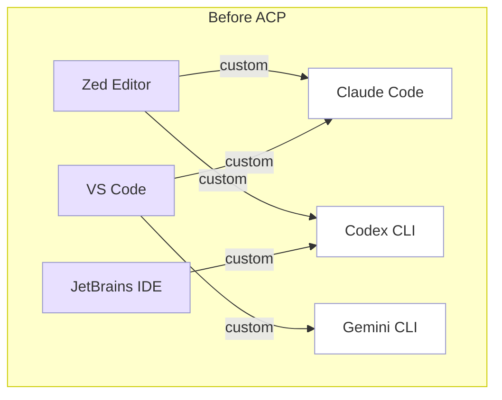
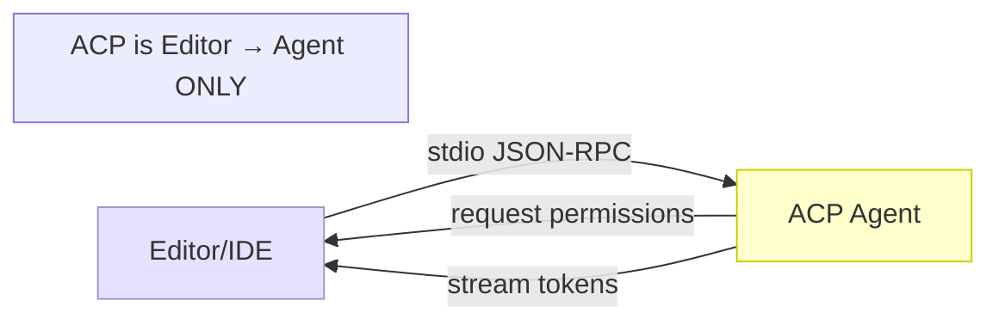
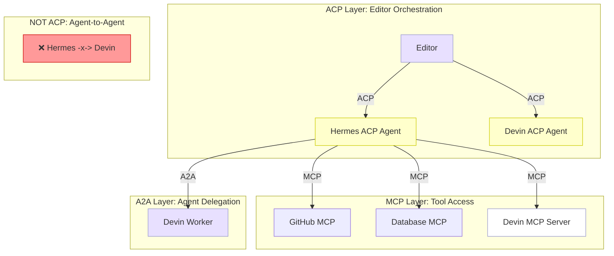
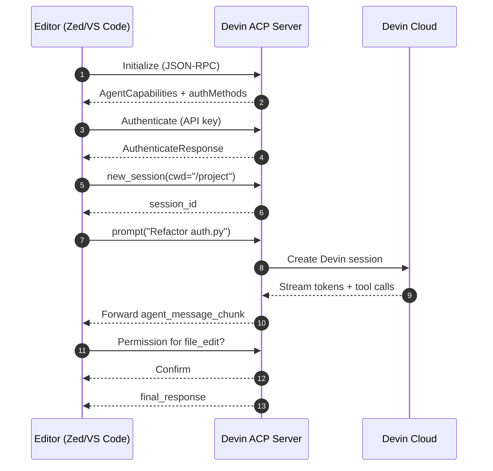

> "LSP standardized language servers. ACP is doing the same for AI coding agents."
> — Zed Industries, *ACP Architecture Overview*

Last month, I was switching between Zed, VS Code, and JetBrains across three different projects. Each editor had its own AI integration: Zed had its native agent, VS Code had Copilot Chat, JetBrains had Junie. I wanted to use Claude Code in all three. Instead, I was maintaining three separate setups, three credential stores, and three keyboard shortcuts that did the same thing differently.

That was the moment the Agent Client Protocol clicked for me. I had been reading about MCP (Model Context Protocol), which solves how agents connect to tools, but I had missed the layer above: how editors connect to agents. ACP fills that gap.

This post is a deep dive into what ACP is, how it works, why it matters alongside MCP, and a runnable walkthrough you can try with your own agent — including Hermes Agent, which I have running locally as an ACP server.

<!--truncate-->

## The Problem: Editor Fragmentation on Top of Tool Fragmentation

MCP standardized the agent-to-tool interface, but left the editor-to-agent interface unstandardized. Before ACP, every agent built custom integrations for every editor.



The result: twenty different AI agents multiplied by five editors equals one hundred custom integrations. Most break on version bumps. None share credentials. Each has its own slash command convention.

ACP replaces this with one protocol. One implementation on the agent side. One standard dialog on the editor side. The comparison with LSP is exact.

## What ACP Actually Is

ACP is a **one-way protocol: Editor → Agent.**

It is a JSON-RPC 2.0 protocol, stdio-first, that defines how an editor (the *client*) launches and **talks to** an AI coding agent (the *server*). Think of it as a session-based chat protocol with tool-calling, file operations, terminal access, and permission management.

**What ACP is not:** two agents do not talk to each other over ACP. Both `devin acp` and `hermes acp` implement the **server role** — they wait for an editor client to connect and send prompts. If you want one agent to instruct another, use MCP (Hermes → Devin's MCP server) or A2A (Agent-to-Agent protocol by Google/Salesforce).

### Key Design Principles

1. **MCP-friendly.** ACP reuses MCP types where possible. An ACP agent can pass MCP server configurations to the editor, and editors can expose their own MCP tools back to the agent.
2. **UX-first.** The protocol is no more abstract than necessary. It includes ACP-specific types for diffs, terminal output, and permission requests — things a generic JSON-RPC protocol would leave unspecified.
3. **Trusted context.** ACP assumes the editor gives the agent access to local files and MCP servers. Tool calls are still gated by permissions, but the agent operates within the user's existing workspace.

### Transport

ACP defaults to stdio: the editor spawns the agent as a sub-process, and all communication happens over stdin/stdout. Each connection supports concurrent sessions — multiple independent threads of conversation within the same agent process.



A Streamable HTTP transport is in RFC. When finalized, it will allow remote agents (cloud-hosted or on a separate VM) to connect over HTTP with Server-Sent Events.

## ACP vs MCP vs A2A: The Full Stack

These three protocols solve different problems and are not interchangeable.

| Concern | Protocol | Direction | Transport | Best For |
|---|---|---|---|---|
| Editor ↔ Agent | **ACP** | Client → Agent | stdio / HTTP (RFC) | Editor integration |
| Agent ↔ Tools | **MCP** | Agent ↔ Data source | stdio / HTTP+SSE | Connecting agents to external APIs |
| Agent ↔ Agent | **A2A** | Agent ↔ Agent | HTTP POST | Cross-vendor agent delegation |

The stack is layered:



You do not need all three. ACP alone gets you editor integration. MCP alone gets you tool access. A2A is for multi-agent orchestration across vendors.

## Running ACP Locally: Hermes Agent

I will walk through the setup I verified on my machine — no theoretical placeholders.

### Prerequisites

- Python 3.11+ with `pip` or `uv`
- An AI provider API key (OpenAI, Anthropic, etc.)
- A terminal

### Step 1: Install Hermes Agent with ACP support

```shell
$ pip install 'hermes-agent[acp]'

# Or with uv:
$ uv pip install 'hermes-agent[acp]'
```

This installs the `agent-client-protocol` package and registers:
- `hermes acp`
- `hermes-acp`
- `python -m acp_adapter`

### Step 2: Verify the adapter

```shell
$ hermes acp --check
Hermes ACP check OK

$ hermes acp --version
0.13.0
```

### Step 3: Configure your provider

```shell
$ hermes model
# Interactive setup — select provider, paste API key, choose default model
```

Store credentials in `~/.hermes/.env` (never commit this file):

```shell
$ cat ~/.hermes/.env
OPENAI_API_KEY=sk-...
ANTHROPIC_API_KEY=sk-ant-...
```

### Step 4: Start the ACP server

```shell
$ hermes acp
2026-05-16 13:34:35 [INFO] acp_adapter.entry: Loaded env from /Users/vishal/.hermes/.env
2026-05-16 13:34:35 [INFO] acp_adapter.entry: Starting hermes-agent ACP adapter
2026-05-16 13:34:35 [INFO] acp_adapter.server: ACP client connected
2026-05-16 13:34:35 [INFO] acp_adapter.server: Initialize from test (protocol v1)
```

The server reads JSON-RPC messages from stdin and writes responses to stdout. Stderr is reserved for logs, so stdout stays clean for protocol traffic.

### Step 5: Connect from Zed

Zed v0.221+ supports ACP natively:

```shell
# In Zed's UI:
# 1. Open the Agent Panel
# 2. Click "Add Agent" or run `zed: acp registry`
# 3. Search for "Hermes Agent"
# 4. Click Install and start a new Hermes external-agent thread
```

Zed launches Hermes via the registry entry:

```text
uvx --from 'hermes-agent[acp]==0.13.0' hermes-acp
```

For local development before the registry entry, add a custom agent to Zed's `settings.json`:

```json
{
  "agent_servers": {
    "hermes-agent": {
      "type": "custom",
      "command": "hermes",
      "args": ["acp"]
    }
  }
}
```

### Step 6: Connect from VS Code

Install the ACP Client extension. Then add Hermes to VS Code settings:

```json
{
  "acp.agents": {
    "Hermes Agent": {
      "command": "hermes",
      "args": ["acp"]
    }
  }
}
```

### What Hermes Exposes in ACP Mode

The `hermes-acp` toolset is curated for editor workflows:

| Category | Tools |
|---|---|
| File operations | `read_file`, `write_file`, `patch`, `search_files` |
| Terminal | `terminal`, `process` |
| Web | `web_search`, `web_extract`, `browser_navigate` |
| Memory | `memory` (persistent), `session_search` |
| Skills | `skill_view`, `skill_manage` |
| Code | `execute_code`, `delegate_task` |

The session manager binds each session's working directory to a task-scoped cwd override, so file tools operate relative to the editor workspace, not the ACP server process.

## The ACP Registry: One-Click Agent Installation

In January 2026, JetBrains and Zed launched the ACP Agent Registry. It is a curated, CI-validated catalog of agents that support authentication. Fetch it programmatically:

```shell
$ curl -s https://cdn.agentclientprotocol.com/registry/v1/latest/registry.json | jq '.agents | map(.name) | .[0:10]'
[
  "AgentPool",
  "Augment Code",
  "AutoDev",
  "Blackbox AI",
  "Claude Agent",
  "Cline",
  "Codex CLI",
  "Codex",
  "Code Assistant",
  "crow-cli"
]
```

The registry tracks 42+ agents as of May 2026, including Claude Code, Codex CLI, Gemini CLI, Cline, Junie (JetBrains), Goose, and Hermes Agent.

Each registry entry includes:
- `id`, `name`, `version`, `description`
- Distribution info (`uvx`, `npx`, `binary`)
- Authentication methods (OAuth or terminal-based)
- Icon (16x16 SVG, monochrome)

CI validates every entry: schema compliance, slug uniqueness, icon format, URL accessibility, and ACP handshake correctness.

## Devin and ACP: A Production Example

Devin for Terminal shipped `devin acp` as a stable subcommand. The integration demonstrates how a remote-hosted agent exposes itself through ACP:



Key behaviors Devin exposes through ACP:
- `/ask`, `/compact`, `/context`, `/undo-add-dir` slash commands
- Elicitation capability (structured form-based input)
- Per-tool metadata for client-side presentation decisions
- Streamed shell output preserved after command completion

Devin's ACP sessions require host-provided credentials rather than falling back to local CLI credentials, ensuring usage is properly attributed.

## Why This Matters at Work

If you are a platform engineering lead deciding which AI agents to support for your team, ACP changes the equation.

**Before ACP:**
- Enable Copilot for VS Code users
- Enable Junie for JetBrains users
- Enable Zed's native agent for Zed users
- Maintain credential stores in three places
- Train documentation in three formats

**With ACP:**
- Pick one agent (or let users pick)
- Install it once through the registry
- Works in every editor that speaks ACP
- Single credential store
- Slash commands are normalized

The cost of supporting a new agent drops from "custom integration per editor" to "verify ACP compliance once." The cost of supporting a new editor drops from "integrate every agent" to "implement ACP once."

This is especially relevant in regulated environments. ACP's explicit permission model — where the editor gates every tool call — makes it easier to build audit trails and policy enforcement than ad-hoc agent integrations.

## Comparison Table: Protocols at a Glance

| | MCP | ACP | A2A |
|---|---|---|---|
| Direction | Agent ↔ Tools | Editor ↔ Agent | Agent ↔ Agent |
| Transport | stdio / HTTP+SSE / Streamable HTTP | stdio (default) / HTTP (RFC) | HTTP POST |
| Discovery | Client lists tools at session start | Editor launches known agent | Agent Cards at `/.well-known/agent.json` |
| State model | Mostly stateless | Session-scoped | Task-scoped, persistent |
| Auth | None locally; OAuth for hosted | None locally; OAuth/terminal for remote | OAuth2 / API keys |
| Setup effort | Low | Very low | Medium |
| Best for | Tool/data interfaces | IDE/CLI agent orchestration | Cross-vendor agent delegation |
| Reach today | ~97M SDK downloads/month | 42+ agents, 4+ editors | 50+ enterprise partners |
| Governance | Linux Foundation / AAIF | Zed + JetBrains (co-maintaining) | Linux Foundation |

## Trade-offs and Limitations

ACP is not a complete replacement for direct integrations. Three scenarios where native integration still wins:

1. **UI richness.** ACP defines message content blocks (text, images, diffs, terminal output) but does not specify rendering. A native VS Code Copilot extension can build custom webviews ACP cannot standardize.
2. **Platform features.** Copilot's inline completions at cursor position are IDE-native features, not ACP messages. ACP handles conversation, not real-time suggestion popups.
3. **Remote auth friction.** ACP's authentication requires the agent to support either OAuth (agent opens browser) or terminal auth. Not all agents implement both. The registry gates on authentication support, which means some interesting agents do not qualify.

The HTTP transport is still in RFC. When it ships, ACP will support remote cloud-hosted agents (like Devin or a central team agent), but today every agent runs as a local child process.

## Try This Now

Run through the setup yourself. This should take under 10 minutes.

```shell
# 1. Install Hermes with ACP support
pip install 'hermes-agent[acp]'

# 2. Verify
hermes acp --check
hermes acp --version

# 3. Set up your AI provider
hermes model

# 4. Start the ACP server
hermes acp

# 5. In a separate terminal, test the JSON-RPC handshake
echo '{"jsonrpc":"2.0","id":1,"method":"initialize","params":{"protocolVersion":1,"clientInfo":{"name":"test","version":"1.0.0"}}}' | hermes acp
```

Then connect it to Zed (v0.221+) or VS Code with the ACP Client extension. If you use JetBrains, wait for JetBrains AI 2025.3+ with native ACP support.

## Further Reading

- [ACP Official Site](https://agentclientprotocol.com)
- [ACP Architecture Docs](https://agentclientprotocol.com/get-started/architecture)
- [ACP Agent Registry](https://github.com/agentclientprotocol/registry)
- [ACP Schema Reference](https://agentclientprotocol.com/protocol/schema)
- [Hermes Agent ACP Integration](https://hermes-agent.nousresearch.com/docs/user-guide/features/acp)
- [Devin ACP Subcommand Docs](https://cli.devin.ai/docs/changelog/stable)
- [JetBrains ACP Announcement](https://blog.jetbrains.com/ai/2026/01/acp-agent-registry/)
- [Zed ACP Blog Post](https://zed.dev/blog/jetbrains-on-acp)

---

*Published on [The Data Column](https://vishalgandhi.in). If you've wired an ACP agent into your editor setup, I'd like to hear what worked and what didn't.*
