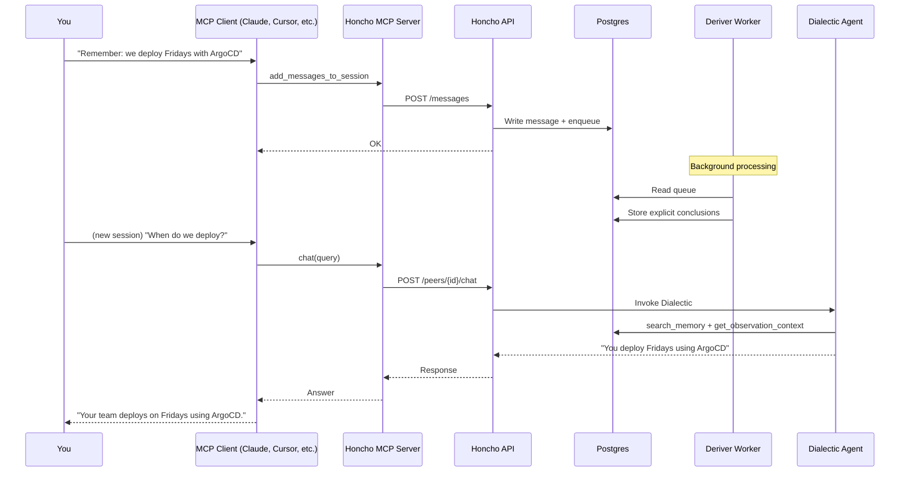

# Exercise: Honcho as Extended Memory

## Goal

Connect an MCP-compatible agent to Honcho. Store a conclusion, query it from a fresh session, and verify that background reasoning keeps your representation current.

## Time Required

20–30 minutes

## Prerequisites

- [ ] An MCP-compatible client — Hermes Agent, Claude Desktop, Cursor, or Windsurf
- [ ] Honcho account with API key (`hch_` prefix) — get one at https://app.honcho.dev
- [ ] `bunx` available (Node.js 18+)
- [ ] Internet access (Honcho MCP server is cloud-hosted)

<!--truncate-->

## Architecture



## Tasks

### Task 1: Get Your Honcho API Key

**Go to:** https://app.honcho.dev → Sign up → Create workspace → Copy API key

**Expected:** A string starting with `hch_`

**Store it somewhere secure** (environment variable, password manager, `.env` file outside version control).

**Why this matters:** Every MCP tool call authenticates via this key. The server routes you to your workspace.

---

### Task 2: Configure Your MCP Client

Add Honcho to your MCP client. Pick your agent:

#### Option A: Hermes Agent

```yaml
# ~/.hermes/config.yaml
mcp_servers:
  honcho:
    command: bunx
    args:
      - mcp-remote
      - https://mcp.honcho.dev
      - --header
      - "Authorization:Bearer hch_your_key_here"
      - --header
      - "X-Honcho-User-Name:your_name"
```

Restart Hermes (`hermes` in terminal or Discord bot restart).

#### Option B: Claude Desktop

```json
{
  "mcpServers": {
    "honcho": {
      "command": "bunx",
      "args": [
        "mcp-remote",
        "https://mcp.honcho.dev",
        "--header",
        "Authorization:${AUTH_HEADER}",
        "--header",
        "X-Honcho-User-Name:${USER_NAME}"
      ],
      "env": {
        "AUTH_HEADER": "Bearer hch_your_key_here",
        "USER_NAME": "your_name"
      }
    }
  }
}
```

#### Option C: Cursor / Windsurf

Add an equivalent entry in `.cursor/mcp.json` or Windsurf's MCP settings.

**Verify:** Restart the client. The Honcho tools should appear in the tool list.

**Why this matters:** The `mcp-remote` bridge connects your local client to the hosted Honcho server via the MCP protocol. A wrong key or missing header means silent failure.

---

### Task 3: Verify Tool Discovery

After restarting, ask your agent:

```
List available Honcho tools
```

**Expected:** You should see tools including:

| Tool | Purpose |
|---|---|
| `chat` | Ask a question — triggers the Dialectic reasoning agent |
| `create_conclusions` | Manually inject knowledge |
| `query_conclusions` | Semantic search across conclusions |
| `list_conclusions` | Paginated list of all derived conclusions |
| `delete_conclusion` | Remove incorrect knowledge |
| `get_peer_card` | Read compact identity summary |
| `set_peer_card` | Write/update peer card |
| `add_messages_to_session` | Store conversation turns |
| `get_session_context` | Retrieve session history with summaries |
| `schedule_dream` | Trigger background consolidation |
| `get_queue_status` | Check Deriver processing status |

**If tools are missing:** Restart the client. Check that `bunx` is on your PATH. Verify the API key format.

---

### Task 4: Store Facts via Conversation

Tell your agent several specific, verifiable things across a few messages:

```
Message 1: We deploy every Friday using ArgoCD to our production k8s cluster.
Message 2: Our API gateway is Kong. We tried Envoy but it was too complex for our team size.
Message 3: All new services must use structured logging with correlation IDs — no print statements.
```

**What happens internally:**
1. Agent calls `add_messages_to_session` to store each turn
2. Honcho API writes messages and enqueues derivation tasks
3. The Deriver (async) extracts explicit conclusions:
   - "Team deploys on Fridays"
   - "Team uses ArgoCD for deployment"
   - "Team deploys to Kubernetes"
   - "Team uses Kong as API gateway"
   - "Team evaluated Envoy but rejected it (too complex)"
   - "Team requires structured logging with correlation IDs"
   - "Team prohibits print statements in production code"

**Verify they were stored:**
```
Search my conclusions for "deployment"
```

The agent should call `query_conclusions` and return the ArgoCD/Friday/k8s conclusions.

```
Search my conclusions for "logging"
```

Should return the structured logging requirement.

---

### Task 5: Query Across Sessions

**Start a brand new session** (new Hermes thread, new Claude conversation, new Cursor chat — zero prior context).

**Do NOT mention ArgoCD, Kong, or logging in your prompt.**

**Ask:**
```
I'm setting up CI/CD for a new service. What does our team do for deployments?
```

**What happens internally:**
1. Agent calls `chat` with your query
2. Honcho's Dialectic agent internally uses `search_memory` to find relevant conclusions
3. Finds "Team deploys on Fridays", "Team uses ArgoCD", "Team deploys to Kubernetes"
4. Synthesizes an answer grounded in your stored conclusions

**Expected:** Something like: "Your team deploys on Fridays using ArgoCD to a production Kubernetes cluster."

**Try another query in the same fresh session:**
```
What should I know before adding a new API route?
```

**Expected:** Honcho surfaces the Kong gateway and structured logging conclusions without you mentioning either.

**Why this matters:** The new session had zero prior context. Honcho bridged the gap. This works across machines and across different MCP clients — ask in Hermes today, query from Cursor tomorrow.

---

### Task 6: Check Background Processing

Ask your agent:

```
What is the Honcho queue status?
```

**What happens:** Agent calls `get_queue_status`.

**Interpret the output:**
- `pending: 0` → All messages have been processed into conclusions
- `pending > 0` → Deriver is still working; recent facts may not surface yet

**If the queue is stuck or you want faster consolidation:**
```
Schedule a dream to consolidate my memory
```

This calls `schedule_dream`, triggering the Dreamer to run DeductionSpecialist and InductionSpecialist on your explicit conclusions.

---

### Task 7: Set and Read a Peer Card

Peer cards are compact identity summaries (max 40 facts) for low-latency injection. Each entry must use a prefix: `IDENTITY:`, `ATTRIBUTE:`, `RELATIONSHIP:`, or `INSTRUCTION:`.

**Ask:**
```
Set my peer card with these facts:
- IDENTITY: Software engineer working on platform services
- ATTRIBUTE: Prefers FastAPI over Flask
- ATTRIBUTE: Uses PostgreSQL 16 for all new services
- INSTRUCTION: Always suggest type-safe approaches
```

The agent calls `set_peer_card`.

**Verify:**
```
What does my peer card say?
```

The agent calls `get_peer_card` and returns your stored facts.

**Why this matters:** Peer cards are faster than full Dialectic queries — ideal for system prompt injection.

---

### Task 8: Delete Outdated Knowledge

If you stored something wrong or outdated:

```
List my conclusions about "attrs"
```

The agent calls `list_conclusions` or `query_conclusions`. Note the conclusion ID.

```
Delete conclusion [id] — we no longer use attrs at all, it's not even worth mentioning
```

The agent calls `delete_conclusion`.

**Why this matters:** Unlike a `MEMORY.md` where stale lines persist forever, Honcho lets you explicitly prune outdated knowledge.

---

## Common Pitfalls

| Symptom | Cause | Fix |
|---|---|---|
| No Honcho tools visible | MCP bridge not running | Restart client; verify `bunx` is available |
| `401 Unauthorized` | Wrong API key | Verify key starts with `hch_` |
| Query returns "No relevant information" | Deriver hasn't processed yet | Wait 30s; call `get_queue_status`; call `schedule_dream` |
| Peer card rejected | Wrong prefix format | Must start with `IDENTITY:`, `ATTRIBUTE:`, `RELATIONSHIP:`, or `INSTRUCTION:` |
| Conclusions stale after correction | Old conclusions not deleted | Explicitly `delete_conclusion` outdated entries |
| Tool calls time out | Network issue or server load | Check internet; retry; Honcho server may be under load |

## Self-Assessment

Verify you can:

- [ ] Configure the Honcho MCP server in your client
- [ ] See Honcho tools (`chat`, `create_conclusions`, etc.) after restart
- [ ] Store a fact via `add_messages_to_session` and find it via `query_conclusions`
- [ ] Query from a fresh session and get a grounded answer (cross-session continuity)
- [ ] Check `get_queue_status` and interpret pending vs. completed
- [ ] Set a peer card with correctly prefixed entries
- [ ] Delete an outdated conclusion
- [ ] Explain: Deriver extracts explicit facts; Dreamer produces deductive/inductive conclusions; Dialectic reasons at query time
