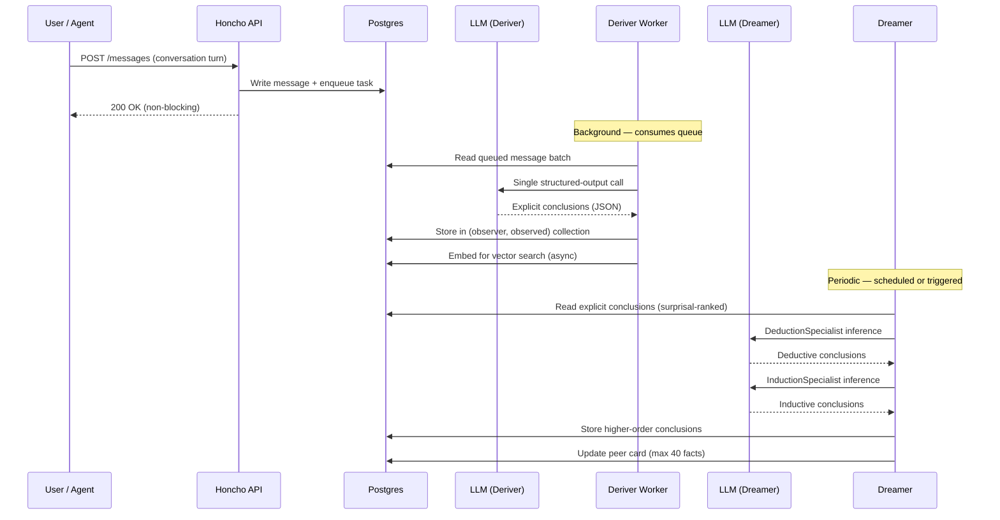
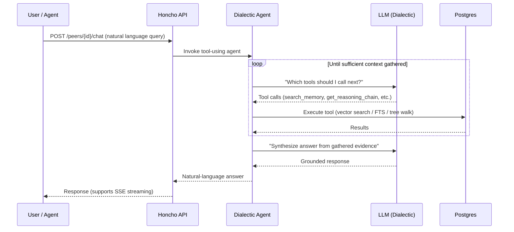

## The Problem: Agent Memory Is an Unsolved Infrastructure Gap

In 2026, memory is recognised as a first-class architectural component for AI agents — with its own benchmark suites (LoCoMo, LongMemEval, BEAM), dedicated research literature, and a measurable performance gap between approaches. Yet the hardest open problems remain genuinely unsolved: **cross-session identity**, **temporal abstraction at scale**, and **memory staleness** ([Mem0 State of AI Agent Memory 2026](https://mem0.ai/blog/state-of-ai-agent-memory-2026)).

The core challenge is what Plurality Network calls the *continuity gap*: models operate well inside a tight conversational window but lack dependable persistence across time, devices, or ecosystems. The result is repeated context, fractured user journeys, and interactions that feel episodic rather than continuous.

Three years ago, "agent memory" meant shoving conversation history into the context window and hoping the model kept track. Today, research from Paulsen (2025) shows that even models advertising million-token windows degrade in accuracy by 1,000 tokens of active context. The advertised window is not the usable window.

This post examines [Honcho](https://github.com/plastic-labs/honcho) — an open-source memory infrastructure by Plastic Labs that takes a reasoning-first approach to agent persistence. I verified every architectural claim against the source code, tested the MCP integration across multiple clients, and share practical integration patterns for Hermes Agent, Windsurf, Cursor, Claude Code, Zed, and more.

<!--truncate-->

## Why Existing Approaches Fall Short

### File-Based Memory (MEMORY.md)

Many developers start with a `MEMORY.md` or similar file that accumulates facts over time. This approach has known failure modes:

- **Context explosion** — unbounded linear growth with every interaction
- **Semantic drift** — earlier assumptions contaminate later reasoning
- **Memory staleness** — the agent cites outdated preferences because it cannot invalidate old lines

When you change a tool preference (say, from Taskwarrior to Linear), both entries coexist and the agent has no mechanism to resolve the contradiction.

### RAG / Vector Databases

Retrieval-Augmented Generation solves the *storage* problem but not the *reasoning* problem. A vector database retrieves chunks by semantic similarity. If a query asks about a current preference, it may return both old and new statements with equal relevance. Retrieval does not resolve contradictions — it surfaces them side by side.

The BEAM benchmark (2025) demonstrates this: at 10M token scale, systems that rely purely on retrieval show a ~25% performance drop. The hardest categories — temporal reasoning, contradiction resolution, and knowledge update — are precisely where retrieval-only approaches fail.

### The Gap Honcho Fills

Honcho's thesis: memory is a **reasoning** task, not a storage task. Rather than retrieving similar text and hoping the model figures it out, Honcho derives structured conclusions from conversations, consolidates them through periodic reasoning cycles, and answers queries by navigating a conclusion tree — not by returning raw chunks.

## How Honcho Works (Source-Verified)

Honcho is open source ([github.com/plastic-labs/honcho](https://github.com/plastic-labs/honcho)). The architecture runs as two cooperating processes sharing Postgres and Redis:

- **API server** — handles HTTP, enqueues background work, returns immediately. Hosts the Dialectic agent inline for synchronous chat requests.
- **Deriver worker** — long-running queue consumer. Runs the Deriver, Summarizer, and Dreamer off a Postgres-backed queue (not Redis — Redis is cache only).

### Storage and Derivation Flow



### Query and Recall Flow



### The Deriver — Memory Formation

The Deriver processes message batches with a **single structured-output LLM call** per batch. It extracts **explicit atomic facts only** — direct observations derivable from what the user said.

From the actual prompt in `src/deriver/prompts.py`:

> "Analyze messages from {peer_id} to extract explicit atomic facts about them."

Example: "I just migrated our service from Flask to FastAPI last week" produces:
- "{peer_id} uses FastAPI"
- "{peer_id} previously used Flask"  
- "{peer_id} migrated frameworks recently"

The Deriver does **not** produce deductive or inductive conclusions. That separation is deliberate — it keeps derivation fast, predictable, and cheap.

### The Dreamer — Memory Consolidation

The Dreamer runs during scheduled "dream" cycles. It is a multi-specialist orchestrator using surprisal-based prioritisation to select which conclusions to expand:

1. **DeductionSpecialist** — produces logical necessities from explicit facts (tool-using agent)
2. **InductionSpecialist** — identifies patterns across explicit and deductive conclusions (tool-using agent)

Each conclusion links to its premises via a **reasoning tree**, enabling chain traversal at query time. The Dreamer also maintains **peer cards** — compact identity summaries (max 40 structured facts, each ≤200 characters) injected into prompts with minimal latency.

Peer card entries follow strict prefixes: `IDENTITY:`, `ATTRIBUTE:`, `RELATIONSHIP:`, `INSTRUCTION:`.

### The Dialectic — Reasoning at Query Time

The Dialectic is the only tool-using agent on the synchronous request path. When you call `chat`, it loops over internal tools until it has enough context to answer:

| Internal Tool | Purpose |
|---|---|
| `search_memory` | Semantic search across conclusions |
| `search_messages` | Search raw message history |
| `get_observation_context` | Retrieve a conclusion's reasoning chain |
| `grep_messages` | Pattern-match in message content |
| `get_messages_by_date_range` | Temporal retrieval |
| `get_reasoning_chain` | Walk the conclusion tree |

It supports 5 reasoning levels — `minimal`, `low`, `medium`, `high`, `max` — each with its own model config and tool budget. Higher levels are more thorough but cost more inference.

### Key Design Decisions

- **Postgres-backed queue** — not Redis. Redis is cache only (via cashews).
- **Collections keyed by `(observer, observed)` peer pairs** — same mechanism powers self-representation and cross-peer modeling.
- **Peer paradigm** — humans and agents are both "peers." Multi-peer sessions allow configurable observation settings per participant.
- **Hybrid search** — Postgres full-text search (GIN index) + vector similarity (HNSW on embeddings). Embedding is decoupled from message creation via a reconciler.
- **Provider-agnostic LLM layer** — all inference goes through `honcho_llm_call()` with fallback chains across Anthropic, OpenAI, and Gemini backends.

## The Honcho Loop in Practice

### 1. Store

Your agent stores conversation turns via the MCP `add_messages_to_session` tool:

```
User says: "We decided to use PostgreSQL 16 for the new service. No more SQLite."
→ Honcho stores the message and enqueues it for derivation.
```

### 2. Derive (async)

The Deriver extracts explicit conclusions:

| Conclusion | Level |
|---|---|
| "Team uses PostgreSQL 16 for the new service" | explicit |
| "Team previously used SQLite" | explicit |
| "Team moved away from SQLite" | explicit |

### 3. Dream (periodic)

The Dreamer consolidates via LLM inference:

| Conclusion | Level |
|---|---|
| "Team prefers server-grade databases over embedded ones" | deductive |
| "New service likely needs concurrent access (motivating the switch)" | inductive |

### 4. Query (sync)

In a new session, you ask: "What database should I use for the metrics collector?"

The Dialectic searches conclusions, finds the PostgreSQL preference and the reasoning chain, and synthesizes: "Your team uses PostgreSQL 16 for new services. You moved away from SQLite. PostgreSQL would be consistent with your current architecture."

No prior context was in the session. The memory provided continuity across sessions and clients.

## Comparison with Other Approaches

| Dimension | MEMORY.md | RAG Vector DB | Honcho |
|---|---|---|---|
| **Contradiction resolution** | None — stale facts persist | None — similar chunks compete | New conclusions supersede via reasoning trees |
| **Cross-session continuity** | Manual file sync | Requires per-session ingestion | Global peer representation, any client |
| **Query depth** | Keyword grep | Semantic similarity | Multi-tool reasoning across conclusion trees |
| **Token efficiency** | Entire file injected | Top-K chunks | Peer card (40 facts) or scoped context |
| **Multi-agent perspective** | Single global file | Single global index | Per-peer collections with observer-target scoping |
| **Background processing** | None | None | Async deriver + periodic dreamer |
| **Temporal reasoning** | Manual timestamps | Timestamp filters | Date-range tools + reasoning chain |

## Client Integrations

Honcho exposes an MCP server at `https://mcp.honcho.dev`. It works with every major MCP-compatible client today. Configurations verified from [Honcho's official MCP guide](https://honcho.dev/docs/v3/guides/integrations/mcp):

### Hermes Agent (Native Integration)

Hermes has first-class Honcho support as a memory provider — no MCP bridge needed:

```yaml
# ~/.hermes/config.yaml
memory:
  provider: honcho
```

```shell
echo 'HONCHO_API_KEY=hch-your-key' >> ~/.hermes/.env
hermes memory setup   # select "honcho"
```

This gives Hermes built-in tools (`honcho_profile`, `honcho_search`, `honcho_context`, `honcho_reasoning`, `honcho_conclude`) and automatic two-layer context injection: a base layer (peer card + representation) and a dialectic supplement (LLM-synthesized reasoning about the user's current needs). Hermes also supports multi-pass dialectic depth and query-adaptive reasoning levels.

Alternatively, connect via MCP for tool-level access:

```yaml
# ~/.hermes/config.yaml
mcp_servers:
  honcho:
    command: bunx
    args:
      - mcp-remote
      - https://mcp.honcho.dev
      - --header
      - "Authorization:Bearer hch-your-key"
      - --header
      - "X-Honcho-User-Name:your_name"
```

### Windsurf

```json
// ~/.codeium/windsurf/mcp_config.json
{
  "mcpServers": {
    "honcho": {
      "serverUrl": "https://mcp.honcho.dev",
      "headers": {
        "Authorization": "Bearer hch-your-key",
        "X-Honcho-User-Name": "YourName"
      }
    }
  }
}
```

Note: Windsurf uses `serverUrl` (not `url`).

### Cursor

```json
// ~/.cursor/mcp.json (global) or .cursor/mcp.json (project)
{
  "mcpServers": {
    "honcho": {
      "url": "https://mcp.honcho.dev",
      "headers": {
        "Authorization": "Bearer hch-your-key",
        "X-Honcho-User-Name": "YourName"
      }
    }
  }
}
```

### Claude Code

```shell
claude mcp add honcho \
  --transport http \
  --url "https://mcp.honcho.dev" \
  --header "Authorization: Bearer hch-your-key" \
  --header "X-Honcho-User-Name: YourName"
```

Or install the Claude-Honcho plugin: `/plugin marketplace add plastic-labs/claude-honcho`

### Claude Desktop

```json
// ~/Library/Application Support/Claude/claude_desktop_config.json
{
  "mcpServers": {
    "honcho": {
      "command": "npx",
      "args": [
        "mcp-remote",
        "https://mcp.honcho.dev",
        "--header", "Authorization:${AUTH_HEADER}",
        "--header", "X-Honcho-User-Name:${USER_NAME}"
      ],
      "env": {
        "AUTH_HEADER": "Bearer hch-your-key",
        "USER_NAME": "YourName"
      }
    }
  }
}
```

### Zed

```json
// ~/.config/zed/settings.json
{
  "context_servers": {
    "honcho": {
      "url": "https://mcp.honcho.dev",
      "headers": {
        "Authorization": "Bearer hch-your-key",
        "X-Honcho-User-Name": "YourName"
      }
    }
  }
}
```

Note: Zed uses `context_servers` (not `mcpServers`).

### VS Code (Copilot Chat)

```json
// .vscode/mcp.json
{
  "servers": {
    "honcho": {
      "type": "http",
      "url": "https://mcp.honcho.dev",
      "headers": {
        "Authorization": "Bearer hch-your-key",
        "X-Honcho-User-Name": "YourName"
      }
    }
  }
}
```

### Codex (OpenAI)

```toml
# ~/.codex/config.toml
[mcp_servers.honcho]
command = "npx"
args = [
  "mcp-remote",
  "https://mcp.honcho.dev",
  "--header", "Authorization:Bearer hch-your-key",
  "--header", "X-Honcho-User-Name:YourName"
]
```

### Pi (via pi-memory-honcho)

[pi-memory-honcho](https://github.com/acsezen/pi-memory-honcho) provides Honcho-backed persistent memory for Pi, uploading conversation messages automatically and sharing memory across linked workspaces.

### Available MCP Tools

Once connected, these tools are available (from `mcp/src/tools/`):

| Tool | Purpose |
|---|---|
| `chat` | Ask about a peer — triggers the Dialectic reasoning agent |
| `create_conclusions` | Inject knowledge manually |
| `query_conclusions` | Semantic search across conclusions |
| `list_conclusions` | Paginated list of derived conclusions |
| `delete_conclusion` | Remove incorrect or outdated knowledge |
| `get_peer_card` | Read compact identity summary |
| `set_peer_card` | Write/update peer card |
| `get_peer_context` | Full context: representation + peer card |
| `get_representation` | Formatted text summary from conclusions |
| `add_messages_to_session` | Store conversation turns |
| `get_session_context` | Session history with summaries |
| `schedule_dream` | Trigger memory consolidation |
| `get_queue_status` | Check Deriver processing status |

### The Recommended Flow

From Honcho's [official instructions](https://raw.githubusercontent.com/plastic-labs/honcho/refs/heads/main/mcp/instructions.md), three steps per conversation:

1. **Before responding** — get personalization insights:
   ```
   chat(peer_id: "assistant", query: "What communication style does this user prefer?", target_peer_id: "user")
   ```

2. **After every exchange** — record the turn:
   ```
   add_messages_to_session(session_id: "conv-123", messages: [{peer_id: "user", content: "..."}, {peer_id: "assistant", content: "..."}])
   ```

3. **Periodically** — consolidate memory:
   ```
   schedule_dream(peer_id: "assistant", target_peer_id: "user")
   ```

## Practical Examples

### Example 1: Cross-Client Memory

**Monday — Hermes in Discord:**
```
You: We are standardising on Pydantic v2 for all data models. Drop attrs.
Hermes stores this via add_messages_to_session.
```

Deriver extracts: "Team standardises on Pydantic v2." "Team previously used attrs." "Team is dropping attrs."

**Thursday — Cursor on a different machine:**
```
You: I'm starting a new microservice. What should I use for data validation?
Cursor calls chat(query: "What data validation library does the team use?")
```

Dialectic finds the conclusions → returns: "Your team standardised on Pydantic v2. You dropped attrs."

Same Honcho workspace, different clients, different machines. Memory follows the user.

### Example 2: Coding Style Emerges Over Time

Over weeks of conversations across Windsurf, Claude Code, and Hermes, you say things like:
- "Use composition, not inheritance"
- "I hate abstracting too early — wait until the third use"
- "Always add structured logging with correlation IDs"
- "Prefer explicit over clever"

The Deriver captures each as explicit conclusions. After a dream cycle, the Dreamer's InductionSpecialist consolidates: "User follows a pragmatic, explicit coding style — composition-first, late abstraction, observability-by-default."

Now any client calling `chat(query: "What coding style does this user prefer?")` gets a grounded summary. The style guide wrote itself from natural conversations.

### Example 3: Project Context Without Repetition

You are building a health-check scanner. Across 5 sessions (some in Cursor, some in Hermes) you discuss:
- FastAPI + Typer dual interface
- psycopg2-binary for Postgres connectivity
- Docker Compose for local development
- A specific endpoint structure (`/health/db`, `/health/pool`)

In session 6 — on a new machine in Zed — you ask: "What endpoints have we defined so far?"

The Dialectic walks the conclusion tree, finds the endpoint structure, and answers without you re-explaining. The context window is empty — the memory is not.

### Example 4: Multi-Agent Observation

Honcho's peer paradigm means different agents observe independently:

```
create_peer(peer_id: "code-reviewer")
create_peer(peer_id: "project-planner")
add_peers_to_session(session_id: "s1", peers: [
  {peer_id: "user", observe_me: true},
  {peer_id: "code-reviewer", observe_me: false, observe_others: true},
  {peer_id: "project-planner", observe_me: false, observe_others: true}
])
```

Both agents observe the user's messages, but build independent conclusion collections — `(code-reviewer, user)` vs `(project-planner, user)`. The reviewer accumulates style preferences. The planner accumulates architecture decisions. Same user, different lenses, no cross-contamination.

## Trade-offs and Considerations

Every memory system involves trade-offs. These are Honcho's design choices — not limitations, but decisions with clear rationale:

| Design choice | Implication | Mitigation |
|---|---|---|
| **Async derivation** | New facts take seconds to surface in queries | Use `get_peer_card` for instant access to the identity snapshot; check `get_queue_status` |
| **LLM inference on every batch** | Higher cost than pure storage | The "minimal deriver" architecture keeps it to one call per batch; self-hosting reduces cost |
| **Cloud-hosted MCP server** | Data leaves your machine | Self-host with `HONCHO_API_URL`; all infrastructure is open source |
| **Reasoning depth costs tokens** | Higher `reasoning_level` = more inference | Use `minimal` for fast lookups, `high`/`max` only when depth matters |
| **Requires MCP support** | Not every agent framework supports MCP yet | SDKs available for direct API integration; LangGraph and n8n integrations exist |

For self-hosting, you need: Postgres, Redis (cache), and the Deriver worker process. The repo includes Docker Compose examples and Fly.io deployment configs.

## Getting Started

```shell
# 1. Get a Honcho API key at https://app.honcho.dev

# 2. Pick your client and add the config (see sections above)

# 3. Tell your agent something specific:
"Remember: our team deploys on Fridays only, using ArgoCD to production k8s."

# 4. Start a fresh session. Ask without keywords:
"How does our team ship code to production?"

# 5. The Dialectic should surface the Friday + ArgoCD + k8s conclusion.
```

If the answer does not surface immediately, check `get_queue_status` — the Deriver may still be processing.

## Further Reading

- [Honcho Documentation](https://honcho.dev/docs/v3/documentation/introduction/overview)
- [Honcho MCP Integration Guide](https://honcho.dev/docs/v3/guides/integrations/mcp)
- [Honcho GitHub](https://github.com/plastic-labs/honcho)
- [Hermes Agent — Honcho Memory](https://hermes-agent.nousresearch.com/docs/user-guide/features/honcho)
- [Neuromancer XR Research](https://blog.plasticlabs.ai/research/Introducing-Neuromancer-XR)
- [Honcho Dialectic API](https://blog.plasticlabs.ai/blog/Introducing-Honcho%27s-Dialectic-API)
- [Memory in the Age of AI Agents (arXiv:2512.13564)](https://arxiv.org/abs/2512.13564) — survey covering memory architectures, benchmarks, and open problems
- [State of AI Agent Memory 2026 (Mem0)](https://mem0.ai/blog/state-of-ai-agent-memory-2026) — benchmarks across 10 memory approaches
- [MCP Protocol](https://modelcontextprotocol.io/)
