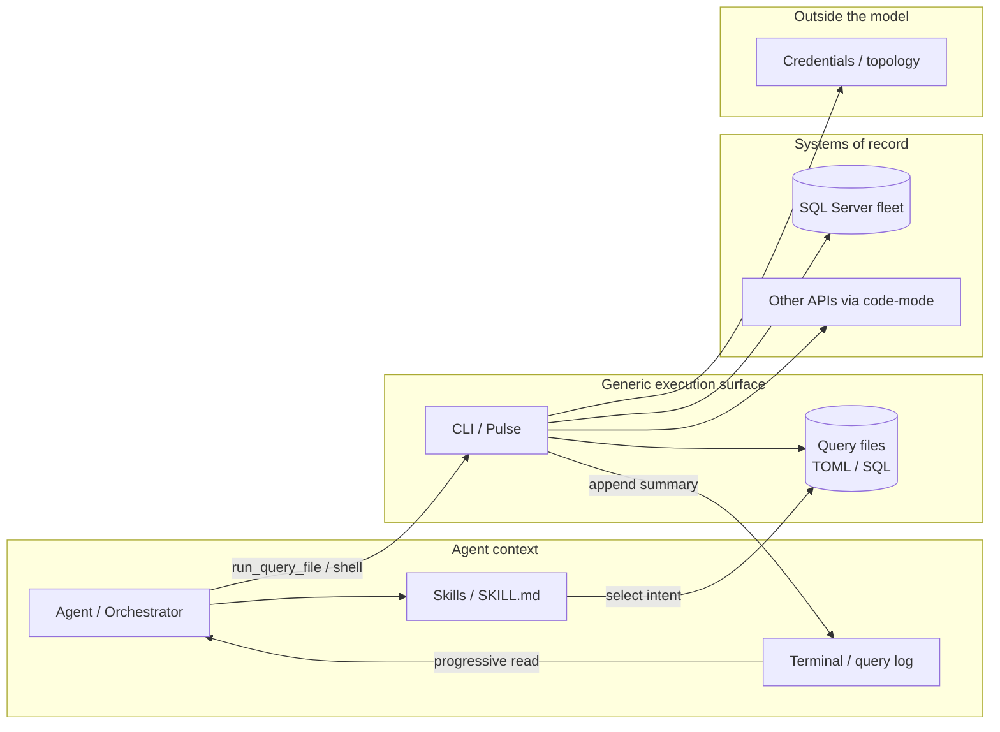

I keep watching teams solve agent capability the same way we once solved integration: one more connector, one more tool definition, one more MCP server. Forty servers later, the agent can "do everything" and somehow sees nothing. The context window is full of schemas. The model is routing. The work is still waiting.

This post is the tool-surface sequel to themes I have been circling — the [N×M MCP integration problem](/blog/mcp-llm-servers), [context-window escape hatches](/blog/multi-agent-context-window), and [the orchestration gap](/blog/what-coding-agents-teach-us-about-concurrency-webhooks-architecture). MCP solved discovery and standardization at the perimeter. The next failure mode is **tool sprawl** inside the context window. The fix is not infinite connectors. It is a thin set of generic execution surfaces — shell/CLI, SQL/query files, skills, APIs-as-code — with **progressive disclosure**, so agents load capability on demand the way operators already do with a fleet SQL CLI.

I learned that pattern from Pulse: a personal/work CLI that runs TOML-defined SQL queries against a large SQL Server fleet. Queries live as files. One CLI executes them. Credentials and connection topology stay with the CLI. A terminal file / query log becomes both the audit trail and the progressive-disclosure surface for agents. Skills teach *when* to pick a query. The agent does not need one MCP tool per SQL check.

<!--truncate-->

## Forty MCP servers and no forest

Picture an agent session that looks "fully connected." GitHub MCP. Jira MCP. Salesforce MCP. Three observability MCPs. A database MCP for every engine. A custom server for every internal API. On paper this is the dream Anthropic described when MCP shipped: implement the protocol once, unlock an ecosystem.

In practice the session opens and the model has already spent a large fraction of its working memory on tool catalogs. Names, descriptions, parameter schemas, annotations — all loaded up front, whether the task needs them or not. A Reddit Claude Code user with Playwright, Context7, Azure, Postgres, and a few other servers reported tens of thousands of tokens burned on MCP tools immediately after `/clear`, before a single user prompt. EclipseSource and others have put the same observation in engineering terms: a "standard" multi-server setup can eat ~20% of a 200K window before you type anything useful.

This is the inverse of the problem I wrote about in the multi-agent context-window post. There, the failure was one agent holding too much *conversation* history. Here, the failure is one agent holding too many *capability* definitions. Context rot does not only come from append-only chat. It also comes from always-on tool menus.

The irony is sharp. MCP was supposed to end the N×M integration tax. It did — at the wiring layer. At the reasoning layer we reinvented N×M as N tools × M servers in the prompt.

## What a fleet SQL CLI taught me

Pulse is a CLI pattern for fleet SQL: TOML-defined queries executed against on the order of thousands of SQL Server instances. I am not going to dump proprietary query bodies, connection strings, or credentials here. The interesting part is not the product; it is the shape.

Four design choices matter for agent architecture:

**1. Queries live as files.**  
A check is a TOML/SQL artifact on disk — versioned, reviewable in pull requests, reusable across operators and automation. The "API" is the filesystem of known intents, not a bag of ad-hoc strings typed into chat.

**2. One CLI executes them.**  
`pulse` (or your equivalent) owns credentials, connection topology, retries, and result formatting. The agent does not assemble a connection string. The agent selects a query file and asks the CLI to run it.

**3. The terminal file / query log is the progressive-disclosure surface.**  
Every invocation lands in a durable log: which query, which target set, summary outcomes, timestamps. For humans that is audit and muscle memory. For agents it is a searchable history — a way to see what already ran, what failed, and what the last known good summary looked like — without reloading the entire fleet result set into the model.

**4. Skills teach selection, not SQL.**  
A skill (or prompt template, or project instruction file) says: "for unauthorized login checks, use this query file; for failed-login windows, use that one; summarize counts before dumping rows." The agent learns *when* to pick a file. It does not need `mcp_check_rogue_logins`, `mcp_failed_logins_last_hour`, and forty siblings.

That is the architectural pattern in one sentence: **capability as versioned files + one generic executor + a log the agent can read + skills that encode judgment.**

If you have lived in SRE or database reliability long enough, this should feel familiar. We already treat runbooks, playbooks, and SQL packs as code. Pulse just makes that discipline the interface an agent should prefer.

## Why tool sprawl hurts — numbers as of September 2026

Anthropic's engineering post *[Code execution with MCP](https://www.anthropic.com/engineering/code-execution-with-mcp)* (November 2025) names the two failure modes cleanly:

1. **Tool definitions overload the context window.** Clients commonly load every tool schema up front. With hundreds or thousands of tools, the model may process a six-figure token tax before reading the user request.
2. **Intermediate results pass through the model.** A transcript downloaded from Drive and written into Salesforce flows through context twice — once as a tool result, again as a write argument. Large documents burn tokens and raise copy error rates.

Their reported example is the one that should be taped to every agent platform whiteboard: presenting MCP servers as a filesystem of code APIs, and letting the agent load only what it needs, cut a workflow from roughly **150,000 tokens to 2,000** — about a **98.7%** reduction. Progressive disclosure is not a slogan. It is an order-of-magnitude lever.

Harness's MCP v2 redesign (March 19, 2026) makes the same point from the platform side. Their first server followed the natural one-tool-per-endpoint pattern. The TL;DR they lead with is **130+ tools → 11** generic verbs; elsewhere in the same post they note the surface had grown to **~175** tools in places. Tool-definition context cost landed around **~26% of a 200K window** before the developer typed a prompt. The v2 redesign collapsed that surface to **11** verbs (`list` / `get` / `create` / …) dispatched through a registry covering 125+ resource types. Estimated tool-definition cost fell to about **~1.6%**. Skills and prompt templates encode workflows so the model reasons about *what* to do while the server handles *how*.

As of August 22, 2026, MCP lead maintainers David Soria Parra and Den Delimarsky put the same honesty into the official roadmap:

> Connecting to a server with a hundred tools means the model pays for that entire surface before the user has asked a single question, and tool selection tends to get worse as the list grows.

They are starting a formal **progressive discovery** effort so a server can offer a small entry point and reveal more of its catalog as the conversation narrows. Until that lands in the spec, the pattern is already implementable in clients and gateways — and it is already what Pulse-shaped cores do with files.

The benchmarks agree that the bottleneck is often *finding* the right tool, not inventing a better prompt.

**LiveMCPBench** (arXiv [2508.01780](https://arxiv.org/abs/2508.01780), August 2025) built a reproducible suite of **70 MCP servers**, **527 tools**, and **95** real-world tasks, evaluated across **12** models. Claude Sonnet 4 topped the board at **~78.95%** task success; most models landed around 30–50%. Retrieval errors accounted for **nearly half** of all failures. Active tool composition correlated with success — the winners chained tools well; they did not win by seeing more of the catalog at once.

**RAG-MCP** (arXiv [2505.03275](https://arxiv.org/abs/2505.03275), May 2025) attacks the same problem from the retrieval side: index tool descriptions, inject only the matches. On their benchmark tasks the approach **more than triples** tool-selection accuracy (**43.13%** vs **13.62%** baseline) and cuts prompt tokens by **over 50%** (roughly 2,134 → 1,084 tokens in their reported table). Same model. Same tools available. Different set placed in front of it.

The broader 2026 discourse has been blunt about CLI versus naive MCP. Scalekit's head-to-head runs (cited in Harness's writeup and elsewhere) found CLI often **10–32×** cheaper on identical GitHub tasks. A simple "what language is this repo?" path cost on the order of **~1,365 tokens via CLI versus ~44,026 via MCP** — almost entirely from schema injection of dozens of unused tools.

Important nuance — and Harness says this well: **the enemy is not MCP; it is naive MCP server design.** Protocol-level auth, per-user OAuth, typed tools, and structured audit still matter at the perimeter. The mistake is mirroring every REST endpoint as a first-class tool definition that must live in every turn's context. MCP's own [client best practices](https://modelcontextprotocol.io/docs/2024-11-05/develop/clients/client-best-practices) already recommend progressive discovery once tool definitions eat a meaningful share of the window (they suggest thinking in **1–5%** thresholds): catalog → inspect → execute, instead of dumping every schema up front.

## Worked example: failed SQL logins in the last hour

Here is a scenario you can recreate conceptually. An operator asks the agent:

> Across production, summarize failed SQL logins in the last hour and list the top offenders.

### Before — naive always-on MCP (*illustrative budget*)

Assume a fleet-check MCP that grew the natural way: one tool per check, schemas always loaded.

| Stage | What happens | Token sketch (illustrative) |
|---|---|---|
| Turn zero | 45 fleet-check tools × ~400 tokens of schema each | ≈ **18,000** tokens of definitions before the question is read |
| First call | `check_failed_logins_1h` returns ~8,000 raw rows through the model | ≈ **25,000** tokens of intermediate data |
| Second call | An "analyze / summarize" tool re-sends a chunk of those rows as arguments | Thousands more tokens, plus copy-error risk |
| Credentials | Connection details often appear as tool parameters or chat paste | Secret surface expands with every specialized tool |

That path is deliberately labeled **illustrative**. The *directional* published numbers point the same way: Anthropic's **150k → 2k** code-execution example; Scalekit's **~44k vs ~1.3k** for a trivial repo question; Harness's **~26% → ~1.6%** of a 200K window spent on tool definitions alone.

### After — Pulse-shaped progressive disclosure

```bash
# conceptual agent path
ls queries/ | head
# skill says: failed_logins_1h.toml
pulse run queries/failed_logins_1h.toml --summary
# terminal / query log appends something like:
# "23 violations / 8 instances; detail: /var/log/pulse/2026-09-05-failed-logins.json"
```

Token path in practice:

- ~3 generic tools (`list_query_files`, `run_query_file` / shell, `read_query_log`) always on
- one skill that names which file to use for "failed logins last hour"
- one query file body loaded only when chosen
- one short summary returned to the model; full JSON stays on disk unless the operator asks for detail

That is a few thousand tokens of working set, not tens of thousands of always-on schemas plus a raw dump. Credentials never enter chat — the CLI already has them.

| Dimension | Always-on MCP soup | Pulse-shaped core |
|---|---|---|
| **Always-on schemas** | Dozens of specialized tools in every turn | 3–11 generic verbs / shell |
| **Intermediate data** | Rows and blobs re-enter the model | CLI aggregates; log holds path + summary |
| **Credentials** | Risk of tool-arg or chat paste | Stay in the executor's config plane |
| **Adding a new check** | Ship a new tool schema to every client | Add a reviewed query file (+ skill line) |

### Mini-example: "debug last deploy" without SQL

The same shape is not SQL-specific. For a platform with registry verbs and skills:

```text
# conceptual
harness_describe(resource_type="pipeline")   # or: search_tools("pipeline failure")
# skill: debug-pipeline-failure → diagnose → follow chained failures
harness_get(resource_type="execution", id=...)
# bulky logs written to workspace; model sees root-cause summary first
```

Generic verbs stay stable. Workflows live in skills. Detail is progressive. That is the same information hierarchy Pulse uses with `queries/` and a query log.

## Generic primitives beat one-tool-per-endpoint

Here is the pattern I want agent stacks to copy from Pulse and from the better MCP redesigns.

| Primitive | Role | What the model sees |
|---|---|---|
| **Shell / CLI** | Generic executor the model already knows | Short commands, `--help` on demand, pipes that filter before stdout returns |
| **Query / skill files** | Versioned intents (SQL, TOML, SKILL.md) | Filenames + short descriptions; full bodies loaded only when chosen |
| **Code-mode APIs** | MCP (or HTTP) exposed as importable functions on a filesystem | Progressive disclosure of schemas; intermediate data stays in the runtime |
| **Registry verbs** | Small fixed vocabulary (`list`/`get`/`run`) over many resources | 10–20 tools, not 200 |
| **Terminal / query log** | Audit + memory | Summaries and paths, not raw dumps unless requested |

Contrast two designs for the same fleet-SQL world.

**Design A — one MCP tool per check (conceptual):**

```text
tools:
  - check_rogue_sql_logins
  - check_failed_logins_1h
  - check_auth_mode
  - check_contained_db_auth
  - check_backup_age
  - check_always_on_health
  - ... 40 more specialized tools ...
```

Every definition sits in context. Every result returns through the model. Credentials risk leaking into chat if someone "helpfully" pastes a connection string into a tool argument. Adding a new check means shipping a new tool schema to every client.

**Design B — Pulse-shaped (conceptual):**

```text
tools (or shell only):
  - run_query_file   # or: bash/pulse
  - list_query_files
  - read_query_log

filesystem:
  queries/
    rogue_sql_logins.toml
    failed_logins_1h.toml
    auth_mode.toml
  skills/
    fleet-sql-triage/SKILL.md
```

The agent lists files, reads a skill, runs one CLI invocation, and reads a summary from the log. New checks are new files. The tool vocabulary stays stable.

```toml
# Conceptual example — structure only, not a real Pulse query
[query]
name = "failed_logins_window"
description = "Summarize failed login attempts in a recent window"
targets = "production"

[params]
window = "1h"
```

```bash
# Conceptual agent action
pulse run queries/failed_logins_window.toml --summary
# → writes a short summary + path into the query log / terminal file
```

That is progressive disclosure the way engineers already work: discover from the filesystem, load the one artifact you need, execute outside the model, return a small result.

## Architecture: agent → skill → CLI → systems



Two boundaries matter:

1. **The model never holds fleet credentials.** The CLI process does. That is not only a security win; it is a token win — connection details do not need to be tool parameters.
2. **The model rarely holds raw multi-thousand-row result sets.** The CLI filters, aggregates, and writes a summary (and optionally a file path) into the log. The agent reads the summary first. Detail is opt-in.

This maps cleanly onto Anthropic's code-execution model, Harness's registry + skills split, and the MCP client guidance of catalog → inspect → execute. The LLM plans and selects. The harness executes and discloses.

## Skills as stateful progressive disclosure of expertise

There is a useful bridge here that is easy to miss if you treat skills as "longer prompts."

Skills done well are **files on disk that the next session reloads** — short frontmatter and steps in context, reference material behind pointers, judgment encoded once instead of re-explained every turn. That is the same information hierarchy Matt Pocock and others describe when writing for agents: keep the top of the ladder legible; disclose depth on demand; prune sediment so each meaning lives in one place. I am not rewriting this post as a skill format guide. The connection that matters for fleet work is simpler.

A `fleet-sql-triage/SKILL.md` that points at `queries/failed_logins_1h.toml`, plus a query log that records what already ran, is progressive disclosure of *expertise* the same way code-mode is progressive disclosure of *schemas*. The skill carries selection judgment. The query file carries the reviewed SQL. The log carries session memory. None of that needs to sit in the always-on tool catalog. Context load stays low; cognitive load for the model stays on the operator's question, not on forty near-synonym tools.

## Credentials out, audit in — and disclosure is not authorization

Pulse-shaped cores buy operational properties that chat-centric tool calling fights against.

**Credentials stay with the executor.**  
The agent invokes `pulse run …` or `run_query_file(path=…)`. Connection strings, Kerberos tickets, vault references, and instance inventories remain in the CLI's configuration plane. You do not invent a new secret channel per MCP tool. You reuse the same hardened path operators already trust.

**The query log is the audit trail.**  
Who ran what, against which target set, with which parameters, producing which summary — that is already how you debug fleet ops. Agents should append to the same log. Voice-mode and automation features that land transcripts next to query results are the same idea: one trail for humans and machines.

**Blast radius shrinks when the allow-list is real.**  
A skill that only allows a curated set of read-only query files is easier to reason about than an agent with `execute_arbitrary_sql` plus production credentials in tool args. Writes can require explicit confirmation — the same elicitation pattern Harness encodes for destructive MCP verbs.

**Progressive disclosure is not access control.**  
Unloading a schema — or never injecting it — is a **token** optimization, not an authorization boundary. If the only thing stopping an agent from calling `delete_instance` is that the schema is not currently in context, a model that guesses the name can still try. Enforce allow-lists and scopes on every real call in the executor or proxy, independent of what is loaded. Dreaming.press's writeups on Microsoft Agent Framework's discover / load / unload pattern and on building progressive disclosure yourself state this cleanly: disclosure changes *when* a permitted tool's schema enters context, never *whether* the tool is permitted. Stride's tool-sprawl notes make the same operator point — hide for attention, gate for security.

**PII and row noise stay filterable.**  
Because filtering happens in the execution environment (shell, CLI, code-mode runtime), you can redact, sample, and aggregate before anything returns to the model. Anthropic's privacy-preserving code-execution examples — tokenize in the client, untokenize only on the wire between systems — are the generalized form of "summarize 23 violations across 8 instances" instead of pasting every row into chat.

For database reliability work, this is not theoretical. Fleet SQL without an audit trail is how you get silent production surprises. Agents make that risk worse unless the architecture forces the trail.

## Limits I will not paper over

Progressive disclosure and Pulse-shaped cores are a trade-off, not a free lunch.

**Code execution needs a sandbox.** Anthropic says this plainly: agent-generated code requires a secure execution environment with resource limits and monitoring. That is operational overhead direct tool calls avoid. You buy token efficiency and composition; you pay for containment.

**Filesystem discovery can fail the same way retrieval fails.** LiveMCPBench's dominant failure mode was retrieval — semantic miss, wrong tool, near-synonym confusion. A messy `queries/` directory with vague filenames recreates that problem on disk. Progressive disclosure only helps if the index (filenames, skill descriptions, registry metadata) is curated.

**Skills rot like runbooks.** A stale skill that points at a renamed query file is a confident wrong answer. Treat skills and query packs as code: review, version, delete the dead ones. Prune sediment.

**MCP still earns its keep at the perimeter.** Multi-tenant OAuth, third-party SaaS discovery, typed enterprise boundaries — that is where the protocol shines. A Pulse-shaped core for fleet SQL does not replace governed access to systems the model has never trained on. Open standards reduce wiring lock-in; they do not decouple your data path, your liability, or your need for an allow-list.

**Illustrative budgets are not lab measurements on Pulse.** Where I sketch token tables for a failed-login scenario, treat them as teaching aids. Lean on the dated primary sources for numbers you cite externally.

## How to apply this when designing agent stacks

A practical checklist I would use on any new agent surface:

1. **Inventory tools by necessity, not by API parity.**  
   If two tools differ only by resource type, they want a registry verb + parameter, not two schemas.

2. **Cap the always-on tool budget.**  
   Aim for a small fixed vocabulary (on the order of Harness's ~11, or a shell + a handful of meta-tools). Treat "over 40 always-loaded tools" as a smell — Cursor's own ~80-tool cap exists for a reason.

3. **Prefer files for workflows and queries.**  
   SQL packs, TOML intents, SKILL.md folders, and code APIs on disk scale without expanding the tool list. Review them like code.

4. **Put a CLI or code-execution sandbox in the middle.**  
   Let the agent compose with pipes, filters, and scripts. Return summaries. Persist bulky intermediates to the workspace. Budget the sandboxing cost explicitly.

5. **Teach with skills, not with ever-longer tool descriptions.**  
   Skills encode ordering, dependency checks, and "when to use which file." Tool descriptions should stay short. Keep each meaning in one place.

6. **Make the log first-class.**  
   Terminal files, query logs, and durable event logs (the OpenHands-style insight from the orchestration post) are how you debug agents *and* how agents recover context without replay-the-world.

7. **Keep MCP at the perimeter where it earns its keep.**  
   Multi-tenant OAuth, third-party SaaS discovery, typed enterprise boundaries — MCP shines there. Do not use it as a mirror of every internal REST path the agent might call once a quarter.

8. **Measure tokens before the first user message.**  
   If tool definitions alone consume double-digit percentages of the window, you are already in debt. Redesign before you add another server. MCP client guidance suggests switching to progressive discovery well before that — think single-digit percent of context, not 20%+.

9. **Connect to multi-agent topology.**  
   Give workers the generic executor and a narrow skill. Keep the orchestrator on summaries and artifacts. Do not make the orchestrator load every team's MCP catalog.

10. **Default to "run the known query file" over "invent SQL in chat."**  
    Invention is for exploration. Production fleet checks should be reviewed artifacts.

11. **Enforce allow-lists outside the prompt.**  
    Progressive disclosure reduces context load. Authorization lives in the executor, proxy, or gateway.

## MCP at the perimeter, Pulse-shaped cores for fleet work

I am not arguing to abandon MCP. I argued for MCP when the N×M matrix was the enterprise pain. That thesis still holds at the edges: standardization, discovery, and governed access to systems the model has never trained on.

What I am arguing is that **the next bottleneck is the tool surface inside the context window**, and that the teams winning on agent reliability are rediscovering an old SRE instinct: thin interfaces, thick files, strong executors, and logs you can trust.

Pulse taught me that pattern in the most concrete domain I know — SQL across a large instance fleet. Queries as files. One CLI. Credentials outside the model. A terminal/query log as the disclosure surface. Skills for judgment. Anthropic's code-execution work, Harness's registry redesign, LiveMCPBench's retrieval diagnosis, RAG-MCP's selection results, and the MCP maintainers' progressive-discovery roadmap are all converging on the same architecture from different directions.

MCP solved how agents *find* tools. The sequel is how agents *carry* them. Stop adding MCP tools by default. Prefer better primitives. Build Pulse-shaped cores for the work that already looks like ops — and keep the protocol where governance and discovery actually need it.

If you are designing an agent stack this quarter, start with a brutal question: **what would this look like if the agent only had a shell, a folder of reviewed query/skill files, and a log?** If the answer is "better," you already know what to delete.

## References

1. **Anthropic Engineering — "Code execution with MCP"** (Nov 4, 2025) — Tool definitions overload context; intermediate results pass through the model; code execution + filesystem progressive disclosure; skills as persisted functions; reported example ~150k → ~2k tokens (~98.7%); sandboxing cost named explicitly. [Link](https://www.anthropic.com/engineering/code-execution-with-mcp)
2. **Harness — "Architecting MCP for AI Agents: Lessons from Our Redesign"** (Mar 19, 2026) — MCP v2 TL;DR: 130+ tools → 11 generic verbs (~175 noted elsewhere in the same post); registry-based dispatch over 125+ resource types; tool-definition context ~26% → ~1.6% of a 200K window; skills encode workflows; cites Scalekit CLI vs MCP (~1,365 vs ~44,026 tokens; 10–32×). [Link](https://www.harness.io/blog/harness-mcp-server-redesign)
3. **MCP Maintainers — "The New MCP Roadmap"** (Aug 22, 2026) — David Soria Parra & Den Delimarsky; progressive discovery priority; "hundred tools" honesty line. [Link](https://blog.modelcontextprotocol.io/posts/mcp-roadmap/)
4. **Stride Techworks — "MCP Tool Sprawl: Why 90 Tools Makes Your Agent Worse"** (fact-reviewed Aug 29, 2026) — Operator summary of roadmap quote, LiveMCPBench, RAG-MCP, and progressive-discovery patterns. [Link](https://www.stridetechworks.com/blog/mcp-tool-sprawl-progressive-discovery)
5. **Mo et al. — LiveMCPBench: Can Agents Navigate an Ocean of MCP Tools?** (arXiv [2508.01780](https://arxiv.org/abs/2508.01780), Aug 2025) — 70 servers, 527 tools, 95 tasks, 12 models; Sonnet 4 ~78.95%; retrieval errors ~half of failures.
6. **Gan & Sun — RAG-MCP: Mitigating Prompt Bloat in LLM Tool Selection via Retrieval-Augmented Generation** (arXiv [2505.03275](https://arxiv.org/abs/2505.03275), May 2025) — Triples tool-selection accuracy (43.13% vs 13.62%); cuts prompt tokens >50%.
7. **Model Context Protocol — Client Best Practices** (docs; progressive discovery / catalog–inspect–execute) — [Link](https://modelcontextprotocol.io/docs/2024-11-05/develop/clients/client-best-practices)
8. **Dreaming.press — Progressive MCP disclosure / discover·load·unload** — Progressive disclosure ≠ access control; allow-lists must enforce on every call. See [Microsoft Agent Framework progressive disclosure](https://dreaming.press/posts/microsoft-agent-framework-progressive-mcp-disclosure.html) and [build it yourself](https://dreaming.press/posts/build-progressive-tool-disclosure-mcp-client.html).
9. **Vishal Gandhi — "Breaking the N×M Barrier: Standardizing Enterprise LLM Integration"** — MCP as the perimeter standardization layer. [Link](/blog/mcp-llm-servers)
10. **Vishal Gandhi — "Escaping the Context Window"** — Multi-agent isolation, artifact handoffs, context rot. [Link](/blog/multi-agent-context-window)
11. **Vishal Gandhi — "What Coding Agents Teach Us About Concurrency, Webhooks, and Design Architecture"** — Runtime scaffolding, durable logs, orchestration as the nervous system. [Link](/blog/what-coding-agents-teach-us-about-concurrency-webhooks-architecture)
