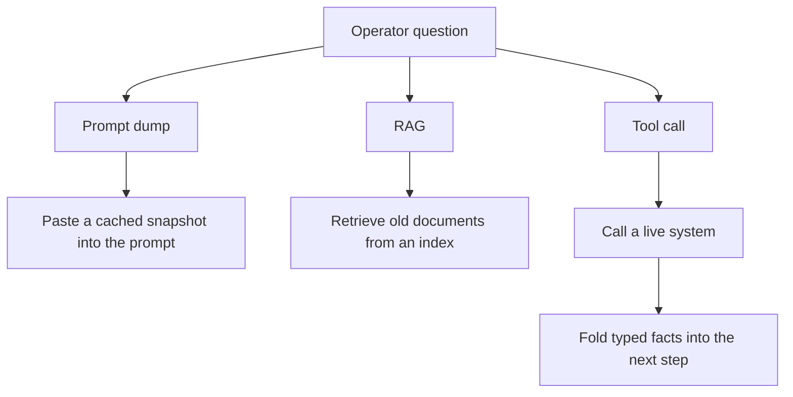

Teams keep treating "give the model current context" as a stuffing problem. Paste last night's status dump into the prompt. Retrieve last quarter's runbook. Call it real-time because the index was rebuilt this morning. That is not how a model learns what is true *now*.

Runtime context is narrower, and harder: the model calls a live system, the system returns structured facts computed at request time, and those facts are folded into the next step of the loop. Agent frameworks such as LangChain and LangGraph are that loop. The durable work is the tool contract — typed facts, scopes, projections — not another wrapper around a prompt.

<!--truncate-->

A prompt dump is a snapshot you already had. Retrieval-augmented generation, as originally defined, is a document index. Neither one is a live health check against the fleet.

## Prompt dump, RAG, and a tool call



Those three arrows look similar in a slide: "context goes into the model." They are not the same job. The first copies bytes you already possessed. The second fetches text that already existed when the index was built. The third asks a system to *compute* an answer — which hosts failed which check, at which severity, for this caller, right now — and then continues.

If you need "which hosts in this region failed their last health check above warn," you are not looking up a document. You are asking a live API to project a fact table.

## What the papers actually claimed

I am not going to rebrand every tool call as RAG. The source papers are more precise than the marketing that followed them.

[ReAct (Yao et al., 2022)](https://arxiv.org/abs/2210.03629) is the loop people now treat as obvious. A language model interleaves verbal reasoning traces with task-specific actions, and the observation from the environment is folded back into the next thought. Reasoning tracks and revises the plan; acting gathers information the model does not already have. Their HotpotQA and FEVER setup used a Wikipedia API, not a live operations system. The shape is what matters: reason, act, fold the observation back. That is a control loop, not a storage model.

[Toolformer (Schick et al., 2023)](https://arxiv.org/abs/2302.04761) is about *who chooses the call*. They train a model to decide which API to call, when to call it, what arguments to pass, and how to incorporate the result into later token prediction. The tools in the paper are a calculator, a QA system, a search engine, a translator, and a calendar. The load-bearing claim is not "stuff more text in the prompt." It is that the model selects the API, the timing, and the arguments.

[RAG (Lewis et al., 2020)](https://arxiv.org/abs/2005.11401) is a document-retrieval baseline, not a live-system design. Parametric memory is a pretrained seq2seq model. Non-parametric memory is a dense vector index of Wikipedia, accessed with a neural retriever. They retrieve passages and condition generation on those passages. That is a strong recipe for knowledge-intensive NLP. It is not a recipe for calling a fleet health endpoint that did not exist as a document until the request arrived. If your "real-time context" is a chunk from last week's wiki, you are doing RAG. Say so.

The [Agentic RAG survey (Singh et al., 2025)](https://arxiv.org/abs/2501.09136) maps how retrieval pipelines grew a control layer. They argue that traditional RAG is a static, linear retrieve-then-generate workflow, and that putting agents into that pipeline — reflection, planning, tool use, multi-agent collaboration — lets the system decide when to retrieve, how to reformulate the query, and when enough evidence has been collected. Read that claim as written. It is a survey of *retrieval control*, not a proof that every live tool call is RAG. An agent that rewrites a search query is still searching a corpus.

Two 2025 papers then make the catalog problem concrete.

[ScaleMCP (Lumer et al., 2025)](https://arxiv.org/abs/2505.06416) starts from a hard limit: model providers cap how many tools you can attach, and a monolithic local tool repo drifts. Their claim is that the agent should retrieve and bind tools at runtime rather than load the whole catalog. They give the agent an MCP retriever and treat MCP servers as the source of truth for the index. You bind the few schemas this turn needs.

[Dynamic ReAct (Gaurav et al., 2025)](https://arxiv.org/abs/2509.20386) applies the same pressure to the ReAct loop. Large MCP tool sets will not fit in context, so they evaluate architectures that search and then load a subset. They report a search-and-load mechanism that cuts tool loading by up to 50% while keeping task completion accuracy. The catalog is retrieved. The *data* still comes from a later call.

[Retrieval models aren't tool-savvy (Shi et al., 2025)](https://arxiv.org/abs/2503.01763) is the warning label on that step. ToolRet covers 7.6k retrieval tasks over a 43k-tool corpus. Information-retrieval models that look strong on conventional document benchmarks do poorly at selecting tools, and that drop in retrieval quality lowers the agent's end-to-end pass rate. Most tool-use evals hide this by pre-annotating a handful of relevant tools. If you retrieve the wrong health-check tool, the loop is faithful and the observation is useless.

ReAct is the fold-back loop. Toolformer is the decision to call. RAG is document retrieval. Agentic RAG is agents steering retrieval. ScaleMCP and Dynamic ReAct are about not loading the whole catalog. ToolRet is why "just embed the tool list" is not a strategy. None of those papers say that stuffing a prompt, or fetching an old document, is runtime context.

## The loop is commodity. The contract is the work.

LangChain and LangGraph will run thought → action → observation until a stop condition. So will every other agent runtime. That cycle is already in Yao et al. Buying a framework does not invent it. What the framework will not invent is the shape of the observation. That is the contract:

| Concern | Prompt dump / RAG | Runtime tool contract |
|---|---|---|
| Freshness | Whatever was snapshotted or indexed | Computed when the call runs |
| Shape | Prose, HTML, or an unbounded JSON blob | Typed facts, declared fields |
| Authority | Whoever could write the doc | Authz scope on the caller |
| Size | "Put it all in context" | A projection, not the warehouse |
| Mutation | Hidden in a generated query | Named preview, then apply |

A health-check tool that returns every probe in the fleet as a free-form blob is not runtime context. It is a prompt dump with extra latency. A call that blocks for three minutes while a full-fleet scan runs is not "real time" just because the bytes are fresh when they finally arrive. "Real time" is the wrong word if the call cannot meet a request budget and the payload has no bound.

Generated SQL is the same failure with a query planner. The model composes `SELECT * FROM checks WHERE …` against the ops store. That is an open query hole, not a tool: the model picks the columns, the rows, and a query that did not exist before this turn. If the model can write the SQL, you do not have a contract.

## A fleet health-check, not a runbook

Take a generic on-call question: *are we degraded in eu-west, and which hosts should leave rotation?*

The prompt-dump path pastes last night's dashboard export. The RAG path retrieves the "fleet health" page from the wiki. Both can be useful background. Neither answers the question that is true at this minute.

The tool path is a call the model is allowed to make:

```text
fleet.health.summary(
  region: "eu-west",
  min_severity: "degraded",
  fields: ["host", "check", "severity", "since"]
)
```

The system computes. It returns twelve rows, not a novel. Those rows become the observation in the next ReAct step. If the following action is "drain these hosts," that is a *different* tool, with a preview of the proposed rotation change, not a `UPDATE` the model invented.

Notice what the contract already decided: region is an argument, not a WHERE clause the model wrote; severity is a floor, not a vibe; the field list is a projection the server can refuse to widen; the caller identity is not in the prompt, it is on the request. That is runtime context. The wiki page about how to interpret a degraded check can still be retrieved. It is a document. Do not confuse the two.

## What to build next

If you already have a loop, stop decorating it. Build the contract the loop is allowed to call.

**An async run id.** If a health scan cannot finish inside the request budget, do not block the model and call the wait "real-time." Return a run identifier and a status the next step can poll. Fresh-but-late is a job, not a synchronous observation.

**Severity-scoped projections.** Critical, warn, and info are not the same payload. The tool chooses the columns for the severity the caller asked for. A warn-level summary should not smuggle host-level debug traces "just in case the model wants them."

**Authz scopes.** The caller's identity is an input to the projection. A regional on-call should not see another region's hosts because the prompt said "show me everything." Scope is enforced in the tool, or it is not enforced.

**A named preview / apply step.** Read the current rotation. Show the proposed drain as a typed diff. Apply only on an explicit second call. One-shot "fix it" tools hide the mutation inside the same observation that was supposed to be a fact.

**No LLM-written SQL.** If the model can compose a query against the fleet store, you have given it the warehouse. Ship named operations with typed arguments. The model chooses among those operations — Toolformer's actual claim — it does not author the query language.

Own the contract. Treat the framework as a loop. Runtime context is a live, typed observation folded into the next step — not a document you happened to retrieve, and not a blob you happened to paste.

## References

- [Yao et al., 2022. ReAct: Synergizing Reasoning and Acting in Language Models](https://arxiv.org/abs/2210.03629)
- [Schick et al., 2023. Toolformer: Language Models Can Teach Themselves to Use Tools](https://arxiv.org/abs/2302.04761)
- [Lewis et al., 2020. Retrieval-Augmented Generation for Knowledge-Intensive NLP Tasks](https://arxiv.org/abs/2005.11401)
- [Singh et al., 2025. Agentic Retrieval-Augmented Generation: A Survey on Agentic RAG](https://arxiv.org/abs/2501.09136)
- [Lumer et al., 2025. ScaleMCP: Dynamic and Auto-Synchronizing Model Context Protocol Tools for LLM Agents](https://arxiv.org/abs/2505.06416)
- [Gaurav et al., 2025. Dynamic ReAct: Scalable Tool Selection for Large-Scale MCP Environments](https://arxiv.org/abs/2509.20386)
- [Shi et al., 2025. Retrieval Models Aren't Tool-Savvy: Benchmarking Tool Retrieval for Large Language Models](https://arxiv.org/abs/2503.01763)
- [Breaking the N×M Barrier: MCP](./2025-12-15-mcp-llm-servers.md)
- [What Coding Agents Teach Us About Concurrency](./2026-07-04-the-orchestration-gap.md)
