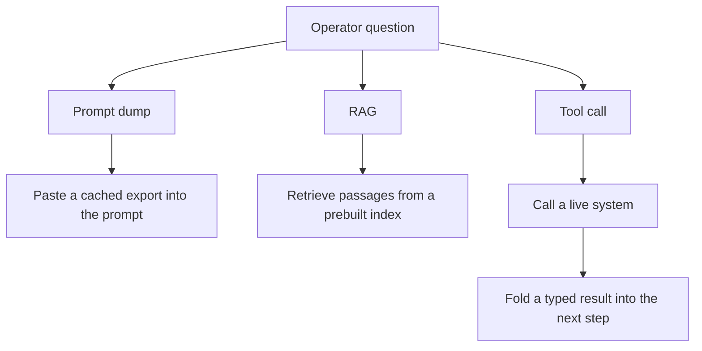

I keep running into the same conflation: a team calls their agent "real-time" because it pastes a fresher export into the prompt, or because the retrieval index was rebuilt an hour ago. Neither one is a live system call, and the difference is not pedantic — it decides whether the number the model just quoted you is true right now or was true whenever someone last ran a job.

Runtime context is narrower than either of those: the model calls a live system, the system computes an answer at request time, and that typed result is folded into the next step. The control loop that does the folding — ReAct, and every agent framework built on it — is thirty seconds of `pip install` away. It has been commoditized since 2022. What has not been commoditized, and what is still mostly unbuilt in the systems I see, is the tool contract on the other end of that call.

<!--truncate-->

## Three things that get called "live context"



A prompt dump is bytes you already had. RAG, as [Lewis et al. (2020)](https://arxiv.org/abs/2005.11401) defined it, retrieves from "a dense vector index of Wikipedia" built in advance — a document index, not a live system. A tool call is the only one of the three where the answer is computed when the request arrives. If "which hosts failed their health check in the last five minutes" is the question, you are not retrieving a passage. You are asking a live endpoint to project a fact table.

## The loop was never the hard part

[ysymyth/ReAct](https://github.com/ysymyth/ReAct) is the original paper's own repo, and it is small enough to read in ten minutes. `wikienv.py` implements three actions — `search[entity]`, `lookup[string]`, `finish[answer]` — against live Wikipedia, and the notebook drives an eight-step Thought/Action/Observation loop:

```python
# based on ysymyth/ReAct, hotpotqa.ipynb
for i in range(1, 8):
    thought_action = llm(prompt + f"Thought {i}:", stop=[f"\nObservation {i}:"])
    thought, action = thought_action.strip().split(f"\nAction {i}: ")
    obs, r, done, info = step(env, action[0].lower() + action[1:])
    prompt += f"Thought {i}: {thought}\nAction {i}: {action}\nObservation {i}: {obs}\n"
    if done:
        break
```

That is the whole mechanism: reason, act, append the observation, repeat. The repo's own README no longer tells you to extend this notebook — it points you at "LangChain's zero-shot ReAct Agent" instead. The loop graduated into the framework layer years ago.

It is still there, just renamed. LangGraph's `create_react_agent` builds a graph that routes a tool-calling model into a `ToolNode` and back until the model stops requesting tools:

```python
from langchain_anthropic import ChatAnthropic
from langgraph.prebuilt import create_react_agent

def search(query: str):
    """Call to surf the web."""
    return "It's 60 degrees and foggy." if "sf" in query.lower() else "It's 90 degrees and sunny."

app = create_react_agent(ChatAnthropic(model="claude-3-7-sonnet-latest"), [search])
app.invoke({"messages": [{"role": "user", "content": "what is the weather in sf"}]})
```

`create_react_agent` is itself already deprecated in favor of `langchain.agents.create_agent` with a middleware system. The loop keeps getting repackaged — LangChain, LangGraph, whatever ships next quarter — because it is genuinely the easy part. [Toolformer (Schick et al., 2023)](https://arxiv.org/abs/2302.04761) is the other half of "easy": they trained a model to decide which API to call, when, and with what arguments, filtering candidate calls by whether the result actually lowered next-token loss. That is the model choosing to act. Neither paper tells you what the tool is allowed to return.

## The catalog is where production actually breaks

Once you have real tools — not one search function, but a fleet of MCP servers — a second problem shows up that neither ReAct nor Toolformer had to deal with: you cannot put every tool definition in context.

LlamaIndex's answer is `ObjectIndex`: embed your tool objects, retrieve the relevant ones at query time, and only pass those signatures to the agent.

```python
from llama_index.core import VectorStoreIndex
from llama_index.core.objects import ObjectIndex
from llama_index.core.agent.workflow import FunctionAgent

obj_index = ObjectIndex.from_objects(all_tools, index_cls=VectorStoreIndex)
agent = FunctionAgent(tool_retriever=obj_index.as_retriever(similarity_top_k=2), llm=llm)
```

That is RAG — real, standard, document-style retrieval — applied to the *catalog*, not to operational data. This is the distinction the Agentic RAG label blurs. [Singh et al.'s survey (2025)](https://arxiv.org/abs/2501.09136) describes agents steering a retrieve-then-generate pipeline — reformulating queries, deciding when enough evidence is collected — and ships a companion list of frameworks on [GitHub](https://github.com/asinghcsu/AgenticRAG-Survey). Read that claim precisely: it is about agents controlling retrieval, not about every tool call being retrieval.

Anthropic shipped the same idea as a product feature in November 2025: the [Tool Search Tool](https://www.anthropic.com/engineering/advanced-tool-use) marks tools `defer_loading: true` so Claude searches a catalog of up to 10,000 tools instead of loading every schema up front — an 85% context-token reduction and an accuracy jump from 49% to 74% on Opus 4, by Anthropic's own numbers. [Arcade.dev stress-tested it](https://www.arcade.dev/blog/anthropic-tool-search-4000-tools-test/) against their own 4,027-tool catalog on 25 real tasks and got 56% success with regex search, 64% with BM25 — missing common tools like `Gmail_SendEmail` outright. That gap between vendor benchmark and independent load test is what [Shi et al.'s ToolRet benchmark](https://arxiv.org/abs/2503.01763) measured academically: strong document-retrieval models score poorly at tool selection, and the [released code](https://github.com/mangopy/tool-retrieval-benchmark) shows the eval is a standard IR benchmark repurposed for 43k tools. [ScaleMCP](https://arxiv.org/abs/2505.06416) and [Dynamic ReAct](https://arxiv.org/abs/2509.20386) report the same fix from the research side — bind only the tools this turn needs, sync the index against the MCP server as the source of truth — and Dynamic ReAct's search-and-load approach cuts tool loading up to 50% without losing task accuracy. Anthropic's [code-execution write-up](https://www.anthropic.com/engineering/code-execution-with-mcp) pushes it further: an agent that reads only the tool files it needs from a filesystem dropped one workflow from 150,000 tokens to 2,000.

None of this is about freshness. It is catalog management: finding the right tool among thousands. Finding the tool and getting a trustworthy, bounded answer from it are different problems, and most of the public engineering effort right now is on the first one.

## The contract is the part nobody ships

The Model Context Protocol's wire format is `tools/call` in, `CallToolResult` out — and the spec already distinguishes an unstructured `content` array from an optional `structuredContent` field for a declared `outputSchema`. Most servers I've looked at return the former: text blobs, not typed facts.

| Concern | Prompt dump / RAG | Runtime tool contract |
|---|---|---|
| Freshness | Snapshotted or indexed earlier | Computed when the call runs |
| Shape | Prose or an unbounded blob | `structuredContent` against a declared `outputSchema` |
| Authority | Whoever could write the doc | Authz scope on the caller |
| Size | Everything, "just in case" | A projection, not the warehouse |
| Mutation | Hidden inside a generated query | Named preview, then apply |

Take a generic on-call question: *are we degraded in eu-west, and which hosts should leave rotation?* A prompt dump pastes last night's export. RAG retrieves the wiki's "fleet health" page. The tool call is a request the model is allowed to make, with the server, not the model, deciding what comes back:

```text
fleet.health.summary(
  region: "eu-west",
  min_severity: "degraded",
  fields: ["host", "check", "severity", "since"]
)
```

Region is an argument, not a `WHERE` clause the model wrote. The field list is a projection the server can refuse to widen. If the scan cannot finish inside the request budget, the right move is an async run id and a status the next step polls — not a three-minute block you call "real-time" because the bytes happen to be fresh when they land. A follow-up action like "drain these hosts" is a different tool, with a named preview of the diff, not an `UPDATE` the model invented on the spot. A model that can compose SQL against your ops store has the warehouse, not a tool.

## What to build next

If you already have the loop — LangGraph, the Anthropic SDK's `tool_use`/`tool_result` cycle, whatever — stop there and build what it calls out to:

- **An async run id** for anything that can't finish inside a request budget, so "fresh but late" is a pollable job, not a blocking call wearing a "real-time" label.
- **Severity-scoped projections**: a warn-level summary and a critical-level one are different payloads, not the same blob filtered client-side.
- **Authz scopes on the caller**, enforced in the tool, so a regional on-call can't see another region's fleet because the prompt asked nicely.
- **A named preview/apply step** for anything that mutates state, so the diff is visible before it's committed.
- **No LLM-written SQL.** Ship named operations with typed arguments and a declared `outputSchema`. The model picks among them — that's Toolformer's actual claim — it doesn't author the query language.

Own that contract and the framework underneath it stops mattering much. Swap LangGraph for something else next year; the typed facts, scopes, and projections are what make the agent trustworthy, and they don't live in the loop.

## References

- [Yao et al., 2022. ReAct: Synergizing Reasoning and Acting in Language Models](https://arxiv.org/abs/2210.03629) — the reference implementation: [ysymyth/ReAct](https://github.com/ysymyth/ReAct)
- [Schick et al., 2023. Toolformer: Language Models Can Teach Themselves to Use Tools](https://arxiv.org/abs/2302.04761)
- [Lewis et al., 2020. Retrieval-Augmented Generation for Knowledge-Intensive NLP Tasks](https://arxiv.org/abs/2005.11401) — code: [huggingface/transformers/examples/rag](https://github.com/huggingface/transformers/blob/master/examples/rag/)
- [Singh et al., 2025. Agentic Retrieval-Augmented Generation: A Survey on Agentic RAG](https://arxiv.org/abs/2501.09136) — companion list: [asinghcsu/AgenticRAG-Survey](https://github.com/asinghcsu/AgenticRAG-Survey)
- [Lumer et al., 2025. ScaleMCP: Dynamic and Auto-Synchronizing Model Context Protocol Tools for LLM Agents](https://arxiv.org/abs/2505.06416)
- [Gaurav et al., 2025. Dynamic ReAct: Scalable Tool Selection for Large-Scale MCP Environments](https://arxiv.org/abs/2509.20386)
- [Shi et al., 2025. Retrieval Models Aren't Tool-Savvy: Benchmarking Tool Retrieval for Large Language Models](https://arxiv.org/abs/2503.01763) — code: [mangopy/tool-retrieval-benchmark](https://github.com/mangopy/tool-retrieval-benchmark)
- [LangGraph `create_react_agent`](https://github.com/langchain-ai/langgraph/tree/main/libs/prebuilt)
- [LlamaIndex `ObjectIndex` tool retrieval](https://developers.llamaindex.ai/python/examples/agent/openai_agent_retrieval/)
- [Anthropic: Introducing advanced tool use (Tool Search Tool)](https://www.anthropic.com/engineering/advanced-tool-use)
- [Arcade.dev: We threw 4,000 tools at Anthropic's new Tool Search](https://www.arcade.dev/blog/anthropic-tool-search-4000-tools-test/)
- [Anthropic: Code execution with MCP](https://www.anthropic.com/engineering/code-execution-with-mcp)
- [Model Context Protocol specification: Tools](https://modelcontextprotocol.io/specification/2025-06-18/server/tools)
